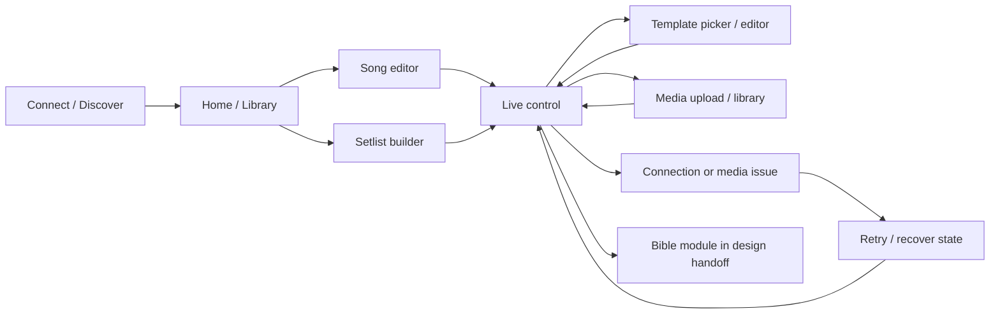

# Dark Spatial design handoff

Figma source: [Mobile Lyrics Presenter — Dark Spatial](https://www.figma.com/design/huTRIbqg23kIuOI8ucj3tJ)

## File structure

- `00 Foundations`: color, spacing, radius, elevation, typography, and motion tokens.
- `01 Components`: reusable button, status chip, text field, and glass panel sets with interactive states.
- `02 Product Screens — Phone + TV`: nine 412×915 phone screens, nine screen-specific error states, and four 1920×1080 receiver states. Connect → Library → Live → error → retry is linked as a prototype flow.

## Design intent and screen workflow

The phone UI uses a dark, calm foundation so the operator can read controls in
a dim room without turning the presentation app into a bright light source.
Panels are grouped by task: library browsing, song editing, live navigation,
templates, and media. The TV uses a separate presentation surface: the
connected `BLANK` and `BLACK` states are truly black; lyrics output has no
controller chrome; connection/address details are reserved for disconnected
status.

The Figma Bible screens describe a possible visual flow, not a claim that a
Bible data module is implemented in the checked-in controller. See the
project's current feature checklist in [README.md](README.md) for shipped
scope. A prototype transition is also not evidence that every Figma frame has
a corresponding production route.

### Phone screen responsibilities

| Screen | Primary question it answers | Main pieces of information/actions |
| --- | --- | --- |
| Connect / Discover | Which receiver should this phone control? | Search/scanning state, discovered TV cards, manual host, remembered connection, connection chip |
| Home / Library | Which song should be presented? | Approximate search, sort, folder navigation, song list, create/import action |
| Song editor | How should lyrics be organized? | Song metadata, section labels, slide text, split/preview and save |
| Setlist builder | What order will songs be presented in? | Ordered songs, drag handles, slide count, add/remove/reorder actions |
| Live control | What is on screen and what is the next operator action? | Connection/live status, current preview, previous/next, slide grid, black/clear and collapsible options |
| Templates / color | What visual treatment should lyrics use? | Built-in/custom styles, typography, alignment, colors, background, fit and dim settings |
| Media | Which uploaded asset should be the background? | Imported image/video list, picker action, upload progress/result, fit and playback controls |
| Settings | How should the controller behave? | Connection and display preferences, recovery guidance, app-level choices |
| Bible concept | How might scripture selection fit the design language? | Version/book/chapter/range flow in the concept file; not currently shipped in source |

### Receiver output states

| TV state | What appears | What remains configured |
| --- | --- | --- |
| Disconnected/listening | Address and receiver readiness guidance | No active controller session |
| Connected `BLANK` | Pure black pixels with no address/status text | No active lyric/background layers |
| `BLACK_SCREEN` override | Pure black cover | Existing lyrics/background/overlay layer state can remain underneath |
| Lyrics | High-contrast song or scripture text using the selected style | Background and overlay can also be active |
| Background only | Full-screen image or video without lyric text | Background fit/playback settings |
| Lyrics over background | Media with lyrics above it and optional dim overlay | Slide changes update lyrics without restarting video |

## Compose token mapping

| Token | Value | Compose mapping |
|---|---:|---|
| Background | `#07080C` | `SpatialColors.Background` |
| Base surface | `#10131C` | `SpatialColors.Surface` |
| Raised surface | `#171B27` | `SpatialColors.Raised` |
| Floating surface | `#202637` | `SpatialColors.Floating` |
| Main text | `#F5F6FF` | `SpatialColors.TextPrimary` |
| Secondary text | `#A4AAC0` | `SpatialColors.TextSecondary` |
| Muted text | `#737B94` | `SpatialColors.TextMuted` |
| Accent | `#7C8CFF` | `SpatialColors.Accent` / Material `primary` |
| Live / secondary | `#F2C879` | `SpatialColors.Gold` / Material `secondary` |
| Success / warning / error / info | `#66D2A5` / `#F2B76B` / `#F17C7C` / `#7FB9FF` | `SpatialColors` semantic values |
| Inner border / focus | white at 12% / `#9AA6FF` | `SpatialColors.InnerBorder` / `FocusBorder` |
| Spacing | 4, 8, 12, 16, 24, 32 dp | `SpatialSpacing.One` through `Eight` |
| Radius | 16, 24, 32 dp | `SpatialRadii.Control`, `Panel`, `Feature` |
| Elevation | 0, 12, 22 dp | `GlassElevation` in `GlassPanel` |
| Motion | 120, 220, 320 ms | Figma motion tokens for general panel/control transitions |
| Live slide crossfade | 90 ms | Receiver `Crossfade` for lyrics navigation; background remains mounted |

## Reusable Compose components

- `GlassPanel`, `SpatialButton`, and `StatusChip` in `SpatialComponents.kt` share panel and control styling.
- `AppMessageHost` is the transient message surface. `AppMessages` converts ACK and media/network failures to short localized title/cause/action copy; no raw ACK JSON or exception text is shown.
- Message policy follows the live-use flow: connection feedback and actionable issues may appear, while successful slide, layer, style, and template changes stay silent. The message surface dismisses after one second.
- `LyricsControllerTheme` and `SpatialBackdrop` are the controller theme/backdrop. Blur is applied only on Android 12+ when the device is not low-RAM; otherwise a solid dark fallback is used.
- `LyricsReceiverTheme` keeps receiver chrome and system bars dark. Connected blank remains pure black; lyric changes crossfade without changing receiver state handling.

### Component use by task

| Component | Intended use | Interaction / state guidance |
| --- | --- | --- |
| `GlassPanel` | Group a task or related controls | Choose base/raised/floating elevation by importance; preserve readable opaque content fills |
| `SpatialButton` | Common primary, secondary, danger, and quiet actions | Keep at least 48 dp touch targets; danger actions such as Clear All remain visually distinct |
| `StatusChip` | Connection and on-air state | Use text and semantic color together; never rely on color alone |
| `AppMessageHost` | Short success/info/error feedback | Use for connection events and actionable issues, not for routine slide navigation or successful style changes |
| Controller preview | Review current lyric/style state before or during live use | Use high-contrast lyric typography and 16:9 proportions; the TV remains the final renderer |
| TV output | Main presentation canvas | No phone-side controls; preserve D-pad focus only for disconnected/interactive TV surfaces |

The live screen is the high-pressure path. Keep next and previous prominent,
thumb-accessible, and visually separate from destructive clear/black actions.
Secondary panels such as templates and media options can collapse so they do
not obstruct the slide grid. Toast-like messages must be brief and reserved
for connection state or an issue requiring attention.

### Visual hierarchy levels

1. **Base:** ambient backdrop and non-interactive page background.
2. **Raised:** song rows, editor groups, discovery cards, and standard panels.
3. **Floating:** dialogs, sheets, or the current live-preview focus.

Use inner borders and subtle glow only to explain hierarchy or focus. Blur is
limited to the ambient backdrop because per-card blur can reduce readability
and frame rate, particularly on lower-end phones. TV slides avoid decorative
glass entirely; the lyrics must remain readable from across a room.

## Accessibility and implementation notes

- Live previous/next/black controls use larger targets and haptic feedback. Compose controls retain Material focus behavior; visible focus tokens are available for TV-facing components.
- The UI uses Android's system sans font so installed Telugu fallback remains available; the lyric line height retains font padding to reduce glyph clipping. Bundling Inter/Plus Jakarta Sans or Noto Sans Telugu assets remains a future asset/licensing choice.
- Component blur is intentionally limited to the ambient backdrop. Content cards use opaque dark fallback fills to keep text readable and avoid per-card blur cost.
- Bible UI/data was not present in the checked-in app source, so this visual pass adds its Figma screen and error state without inventing a new Bible feature or altering application logic.
