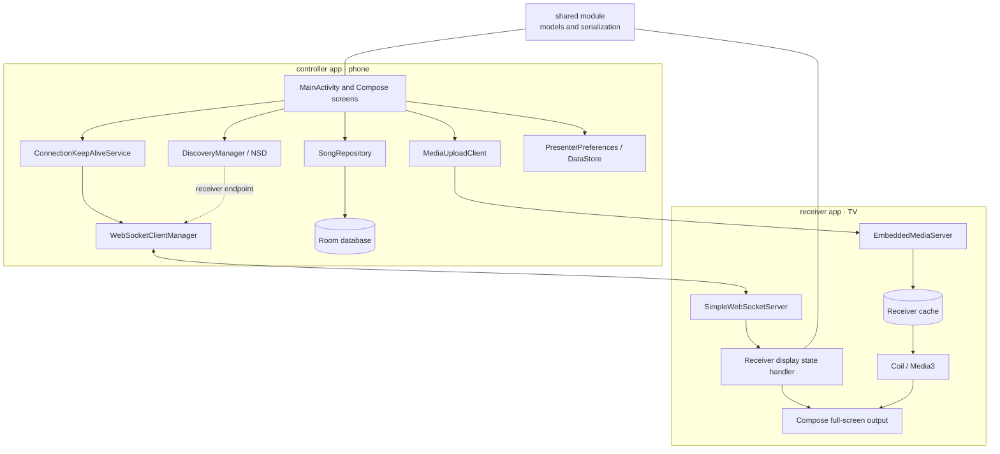
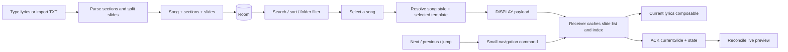
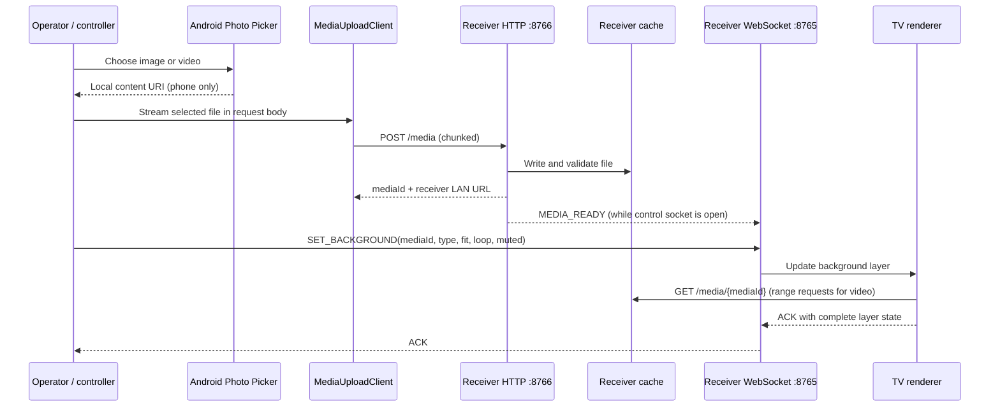
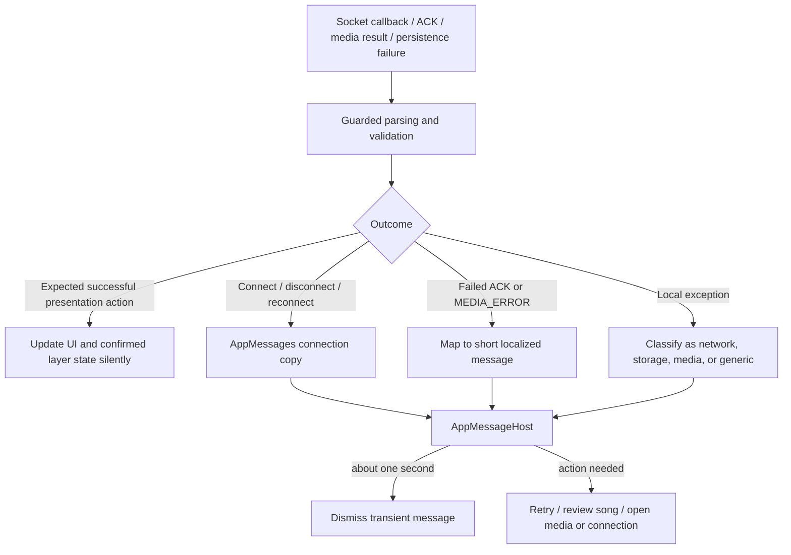

# Development Guide

This guide covers project setup, local testing, and the build flow for the Mobile Lyrics Presenter for Choirs project.

## Dark Spatial UI

The Figma source of truth is [Mobile Lyrics Presenter — Dark Spatial](https://www.figma.com/design/huTRIbqg23kIuOI8ucj3tJ). It contains the Dark Spatial token board, component variants, nine phone flows, four TV states, matching error-state artboards, and the Connect → Library → Live → error → recovery prototype. UI tokens map to `controller/app/src/main/java/com/lyricsapp/controller/DarkSpatialTheme.kt` and `receiver/app/src/main/java/com/lyricsapp/receiver/DarkSpatialTheme.kt`. See `DARK_SPATIAL_DESIGN.md` for the token mapping and implementation notes.

## Project structure

```text
d:\slideshow
├── controller/
│   └── app/
│       ├── src/main/java/com/lyricsapp/controller/
│       ├── src/main/AndroidManifest.xml
│       └── build.gradle.kts
├── receiver/
│   └── app/
│       ├── src/main/java/com/lyricsapp/receiver/
│       ├── src/main/AndroidManifest.xml
│       └── build.gradle.kts
├── shared/
│   └── src/main/java/com/lyricsapp/shared/
├── PROTOCOL.md
├── PROJECT_PLAN.md
├── DEVELOPMENT.md
├── QUICK_REFERENCE.md
├── README.md
├── build.gradle.kts
├── settings.gradle.kts
├── .gitignore
└── LICENSE
```

### Runtime responsibilities



The controller Activity owns screen navigation and user intent; it binds to a foreground connection service so the socket does not belong to a particular Activity instance. The repository is the boundary around persisted songs and folders. DataStore preferences supply templates, colors, remembered receiver, and presentation recovery data. The receiver owns the actual render state and resolves uploaded media from its own cache; it never opens the controller's local picker URI.

### Song-to-screen data flow



TXT parsing recognizes common section headings and blank-line slide breaks. Edits are stored as structured sections and slides. Search, sorting, and folder assignment organize the library without affecting how slides are sent. The first `DISPLAY` carries the song's slides and resolved display settings; following navigation messages carry only the requested movement. An ACK confirms what index and layers the receiver applied.

### Background upload and playback flow



Upload and render are distinct stages: `MEDIA_READY` means the receiver accepted and stored the bytes; `SET_BACKGROUND` makes the item visible. Keep the exact receiver LAN host from the active connection when diagnosing network failures. If a user selects media before a connection is available, the controller may retain the picker reference, but the phone-local URI is not a usable TV playback URL.

## Local environment requirements

- Android Studio with Android Gradle Plugin 8.13.2 support
- Android SDK platform 34 and a suitable Android build tools installation
- JDK 17 (the project compiles Kotlin and Java to JVM 17 bytecode)
- Use the checked-in Gradle wrapper; it downloads/launches Gradle 9.3.0
- A phone and an Android TV, or Android emulator variants for both

The controller minimum SDK is 26 and the receiver/shared minimum SDK is 24.
Both apps target SDK 34. A newer Android Studio may bundle a JDK that the
wrapper can use; if Gradle reports an unsupported runtime, select JDK 17 under
**Settings → Build, Execution, Deployment → Build Tools → Gradle → Gradle JDK**.

## First-time setup

### Open the project in Android Studio

1. Launch Android Studio
2. Choose File > Open
3. Select the repository root: `d:\slideshow`
4. Allow Gradle sync to finish
5. If prompted, install missing Android SDK components

### Validate the Gradle project

From the command line:

```bash
cd d:\slideshow
./gradlew tasks
```

If sync works, you are ready to build and run the apps.

## Build commands

### Build all modules

```bash
cd d:\slideshow
./gradlew build
```

### Build only the TV receiver app

```bash
cd d:\slideshow
./gradlew :receiver:app:build
```

### Build only the phone controller app

```bash
cd d:\slideshow
./gradlew :controller:app:build
```

### Install on connected devices

```bash
cd d:\slideshow
./gradlew installDebug
```

### Install specific app

```bash
cd d:\slideshow
./gradlew :receiver:app:installDebug
./gradlew :controller:app:installDebug
```

## Device setup

### Android TV / TV emulator

Use either:

- a real Android TV with WiFi connected
- an Android TV emulator from Android Studio AVD Manager

### Phone / emulator

Use either:

- a physical Android phone on the same WiFi network
- a phone emulator in Android Studio

## Recommended testing setup

For the best validation you should run:

- controller app on a phone or phone emulator
- receiver app on a TV or TV emulator
- both devices on the same local WiFi network

## Basic connection test

1. Run the receiver app on the TV device
2. Note the TV's local IP address from network settings
3. Run the controller app on the phone
4. Enter the receiver host or IP in the controller
5. Tap Connect
6. Tap Next or Previous to confirm messages reach the TV

## Discovery test

1. Keep the receiver app running on the TV
2. Start the controller app on the phone
3. Wait for the discovery service to find the receiver
4. Choose the TV from the discovered list
5. Confirm the connection opens without manual IP input

## Reconnect test

1. Connect the controller to the receiver
2. Turn off the TV or drop WiFi on the receiver side
3. Wait for the controller to mark the connection as disconnected
4. Restore connectivity
5. Confirm the app reconnects and resumes from the latest display state

## Low-latency navigation and connection recovery

- The controller remembers the last receiver endpoint (host, WebSocket port,
  and display name) in DataStore and attempts it as soon as the connection
  service binds. NSD discovery continues in parallel and publishes each
  resolved service as it arrives.
- `NEXT_SLIDE`, `PREV_SLIDE`, and `JUMP_SLIDE` are queued as compact commands;
  they do not resend song text. The controller preview updates optimistically.
- Application heartbeats run every 30 seconds; one missed ACK is tolerated and
  a reconnect begins only after two misses. OkHttp ping frames run every 25
  seconds. Reconnect delays are capped at 16 seconds.
- While connected, both apps hold a high-performance Wi-Fi lock; the
  controller service also holds a partial wake lock. Some Chinese OEM ROMs
  still require allowing background activity / disabling app battery limits.
- Use `adb logcat -s SlideLatency` to read controller ACK round-trip timing and
  receiver command-to-render timing. These are diagnostic timestamps; actual
  phone-to-TV visual latency must be measured with the two target devices.

## Cross-device background media

The receiver is the HTTP server and the controller pushes selected media with
chunked `POST /media`. This avoids requiring the receiver to read a
phone-local `content://` URI. Port 8766 binds explicitly to `0.0.0.0`; its
upload response and `MEDIA_READY` use an absolute LAN URL built from the local
address of the same network interface that accepted the current WebSocket.
The handshake ACK advertises `mediaHost` and `mediaPort`, and the controller
uses those values for both upload and playback URLs. The receiver serves
`GET /media/{mediaId}` with byte-range support for Media3 seeking. Cleartext
HTTP is enabled by the app manifests for this local-network transport.

To validate with two devices, connect the phone to the TV receiver, upload one
image and one video, confirm that neither `MEDIA_READY` nor `SET_BACKGROUND`
contains `localhost`/`127.0.0.1`, then step through slides and verify the
background persists. Test `CLEAR_SCREEN`, `BLACK_SCREEN`, and
`CLEAR_BACKGROUND` separately. Receiver startup and range responses are logged
under `MediaServer`.

## Connection, error, and feedback path



Protocol JSON and exception details are for diagnostics, not user-facing copy.
Use `AppMessages` to map failures to localized title, cause, severity, and
next action. Successful slide, clear, black, template, and style changes are
kept quiet; brief messages are for connection changes and issues that need
operator awareness. Detailed diagnostics belong in Logcat.

## Heartbeat validation

The controller should send a heartbeat at a fixed interval, and the receiver should answer with a heartbeat acknowledgement.

Check the logs with:

```bash
adb logcat -s "WebSocketClient" "WebSocketServer" "DiscoveryManager"
```

Expected behavior:

- no stale connection remains unnoticed
- disconnects are detected within a short timeout window
- reconnect attempts happen with backoff instead of a flood of retries

## Debugging checklist

### If the controller cannot connect
- confirm both devices are on the same WiFi or hotspot
- verify the receiver host address is correct
- check the receiver app is running
- ensure port 8765 is available and not blocked by a firewall

### If the receiver does not show any updates
- confirm the controller sent a valid JSON message
- inspect logs for parse or socket errors
- verify the receiver is still in the connected state

### If discovery does not work
- confirm both devices are on the same network segment
- ensure the service is actually being advertised on the receiver side
- try manual connection as a fallback while debugging the discovery layer

## Suggested local validation sequence

1. Start receiver app on TV
2. Start controller app on phone
3. Verify controller status changes to connected
4. Send `NEXT_SLIDE` and confirm receiver updates
5. Send `PREV_SLIDE` and confirm the prior slide appears
6. Trigger `BLACK_SCREEN` and then `CLEAR_SCREEN`
7. Disable WiFi briefly and confirm reconnect logic
8. Re-run long session test for 10–20 minutes

## Android Studio workflow

### Debugging in Android Studio

- open the Logcat tab
- use filters for `WebSocketClient`, `WebSocketServer`, and `DiscoveryManager`
- run the receiver app on the TV emulator or device
- run the controller app on the phone emulator or device

### Emulator recommendations

For reliability, use different emulator targets:

- Android TV emulator for the receiver
- ordinary phone emulator for the controller

This ensures the app is tested against the real device form factors it targets.

## Testing by phase

### Phase 1 checks
- receiver starts and shows ready state
- controller can connect and send navigation messages
- receiver updates display based on message type
- reconnect logic triggers after network drop
- service discovery finds the receiver

### Phase 2 checks
- songs can be created, edited, and saved locally
- slides can be split and reordered
- setlist order persists and can be restored

### Phase 3 checks
- live control remains steady during a quick service flow
- next/previous controls respond fast
- jump-to-slide works correctly

### Phase 4 checks
- readability on a large TV screen
- theme controls persist correctly
- clear and black transitions feel intentional

## Troubleshooting matrix

| Problem | Likely cause | Suggested fix |
| --- | --- | --- |
| No connection | Same network not available | Put both devices on same WiFi or hotspot |
| Receiver not discovered | NSD not started or wrong service type | Check discovery configuration and logs |
| Messages not displayed | WebSocket not open | Verify connection and check logs |
| Reconnect fails | Timeout or stale socket | Reset socket and retry with exponential backoff |
| UI not updating | stale state on client | resend latest display state after reconnect |

## Media transfer and playback

The receiver owns the media endpoint on TCP port 8766, advertised as the
`mediaPort` NSD attribute and repeated in the WebSocket handshake ACK. The
controller streams Photo Picker input with HTTP chunked transfer encoding to
`POST /media`; the receiver writes directly into its cache instead of routing
large media bodies through the WebSocket or keeping the whole upload in RAM.
This choice keeps WebSocket heartbeats responsive and gives Media3 a stable
receiver-local URL with HTTP byte-range seeking. The cache is app-local and can
be reclaimed by Android; re-upload media if its ID is no longer available.
Uploads are limited to 2 GiB. The HTTP endpoint is cleartext but only intended
for the same trusted local network, like the existing WebSocket endpoint.

Images use Coil with a crossfade and target-size decoding. Videos use Media3
with looping and mute enabled by default; the player is released when its
screen lifecycle stops or disposes. Fill, fit, and stretch map to crop, fit,
and fill-bounds rendering. Unsupported codecs and storage failures return an
HTTP error and a `MEDIA_ERROR` event where the WebSocket is still connected.
The controller's Media tab keeps the imported-media grid and picker thumbnail
references in DataStore, using persistable document-picker access.

The receiver hides system bars and requests the highest supported display mode
at or above 3840x2160 when available; devices without that mode keep their
native resolution and still render edge-to-edge. The song creator uses a 16:9
preview scaled against the receiver's logical display width. The live template
picker is collapsed by default and expands inline when its header is selected.
The controller turns connection events and failures into short, friendly
messages instead of rendering raw protocol JSON. Successful presentation
changes (slide navigation, clear/black actions, style/template changes, and
media-ready notifications) stay silent. Messages disappear after one second.

For cross-device media playback, the controller builds the media URL from the
same resolved receiver host used by its WebSocket connection. The receiver
accepts regular and suffix byte ranges (`bytes=N-M`, `bytes=N-`, and
`bytes=-N`) for seeking. The media endpoint remains on the receiver, so phone
local `content://` URIs are never sent to the TV.

## Protocol v2 and templates

See [PROTOCOL.md](PROTOCOL.md) for the optional handshake, layer, template, and
media messages. Older protocol fields and command names are unchanged. Built-in
templates are immutable; custom templates are stored as JSON in controller
DataStore. Template payloads travel in full with `APPLY_TEMPLATE`, so the TV
does not need the controller's template store.

Template metadata includes an outline color for future-compatible style
payloads, but the current receiver renderer only draws text shadow; an outline
stroke is not yet visible on the TV. The color controls themselves and
background color/gradient rendering are separate, supported settings.

## Log commands

```bash
adb logcat
adb logcat -s "WebSocketClient" "WebSocketServer" "DiscoveryManager"
adb devices
```

## Useful developer reminders

- Keep the protocol simple and backward-compatible
- Preserve local-first behavior
- Prefer network reliability over fancy features early in development
- Validate on actual Android TV hardware before broad feature expansion
- Make display readability a top priority; it matters more than aesthetics in a live church setting

## Current validation checklist

The application features described above are implemented in code, but device-
specific behavior must still be verified. On a phone and TV on separate devices:

- [ ] Build all modules with `./gradlew build`.
- [ ] Connect, confirm the receiver becomes pure black, and display a song.
- [ ] Rapidly navigate and compare visible TV timing with `SlideLatency` logs.
- [ ] Confirm only connection/error events produce transient messages and they
  disappear after about one second.
- [ ] Upload a 1080p image and video; verify the URLs use the receiver LAN IP.
- [ ] Step through slides while video plays; clear lyrics/background/all
  independently and reconnect Wi-Fi.
- [ ] Reapply a built-in and saved custom template after app restart.
- [ ] Search with a title typo, change sort order, create a folder, move songs, and verify folders persist after restart.
- [ ] Check Telugu text, TV focus, 4K mode selection, and long-session memory.

Do not interpret an unchecked item as a known code failure; it identifies a
manual acceptance check that requires the target hardware or a fresh build.

## Current implementation focus

Core controller, receiver, protocol, media transport, templates, and layer
controls are present. Remaining work is compatibility and acceptance testing:
TV codec support, real-network media reliability, visible latency, background
survival across long sessions, and visual parity on different TV models.

## Presentation connection reliability

The controller's `ConnectionKeepAliveService` owns the OkHttp WebSocket,
heartbeat and reconnect jobs; Activities bind to it for state updates and must
not close the socket when they stop or rotate. The service runs in the
foreground with a low-importance notification and a bounded partial wake lock.
The last host, display payload, active background, and visibility override are
persisted so a service/process restart can reconnect and restore the same
presentation after the receiver's blank handshake. Reconnect waits use 1, 2,
4, 8, then 16 seconds; two missed heartbeat acknowledgements force a reconnect.

Battery optimization restrictions vary by manufacturer. The app offers a
shortcut to Android's battery optimization settings after repeated connection
drops. On some Chinese OEM Android ROMs, also enable the app's **Allow
background activity** / auto-start setting in the manufacturer's app settings.
These controls are outside Android's standard battery settings and names vary
by device.

Receiver output is independent background, lyrics, and overlay layers. Slide
commands and `CLEAR_SCREEN` do not tear down active media. `BLACK_SCREEN` is a
black cover over retained layer state; use `CLEAR_BACKGROUND` or `CLEAR_ALL` to
remove media. On every socket open, the TV first enters pure-black `BLANK` and
waits for the controller's persisted state restore.
