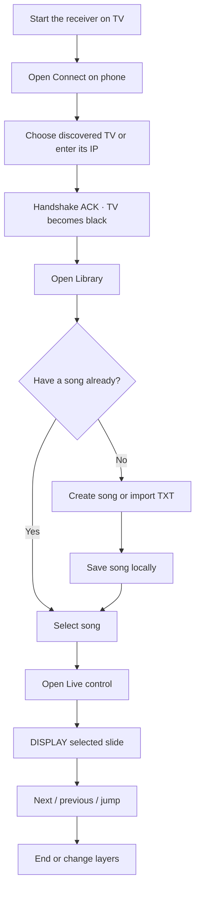
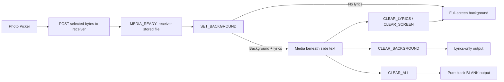

# Getting Started

This guide covers opening the project, building the apps, and connecting a phone controller to an Android TV receiver.

## Prerequisites

- Android Studio with the Android SDK versions required by the Gradle project.
- The JDK configured by Android Studio / Gradle.
- One Android phone and one Android TV device or separate phone/TV emulators.
- Both devices on the same Wi-Fi network or phone hotspot for cross-device control and media.

## Open and sync

1. Open Android Studio and choose **File → Open**.
2. Select the repository root (`D:\slideshow`).
3. Allow Gradle sync to complete and install any requested SDK components.
4. The project contains the `controller`, `receiver`, and `shared` modules.

## Build

From the project root:

```bash
./gradlew build
```

For module-specific builds, use `./gradlew :controller:app:build` or `./gradlew :receiver:app:build`.

## Launch the apps

1. Run the `receiver` app on the TV device/emulator. While disconnected, it shows its listening/address screen.
2. Run the `controller` app on the phone device/emulator.
3. Select the discovered receiver or enter its LAN IP manually.
4. On successful connection, the receiver clears to pure black until the operator displays lyrics or media.
5. Choose a song and use the live controls to present slides.

## First complete presentation



### Create or import song content

Create a song in the editor by entering its title and lyrics. Divide lyrics
into presentation slides with blank-line breaks; optional section headings
such as `[Verse 1]` and `[Chorus]` organize the song into sections. Save the
song to add it to the local Room library. To bring in plain text, use the TXT
import flow and choose whether to apply an available template during import.

In the Library, use the search field for approximate title/author matches,
choose a sort order, and optionally filter by a folder. Create folders to group
songs by service, event, or another convention; moving or deleting a folder
does not alter the actual song slides. Setlists provide an ordered sequence of
songs for a service.

### Use templates

The Styles/Templates area includes built-in styles and custom copies. Built-ins
are read-only; duplicate one to create a custom style, then edit its font,
size, weight, italic style, text colors, alignment, line spacing, safe-area
padding, background type/color/media, fit, and overlay dim. Save the style to
DataStore. Applying a template sends its full style payload to the receiver,
so the TV does not need to have that template saved locally. The song editor
also provides a 16:9 preview to inspect placement before sending a song live.

### Use image or video media

Import an image or video in the Media area. The picker grants the controller a
local URI. The controller streams the file to the receiver over HTTP; the TV
stores the bytes in its app cache and reports a `mediaId`/reachable URL. Select
the uploaded item to set it as the background. Choose Fill, Fit, or Stretch as
needed. Video defaults are looped and muted. Background and lyrics are
independent: clear lyrics to show media alone, clear the background to show
lyrics alone, or use Clear All for a blank output.



Use separate phone and TV emulators for UI development. Same-device testing can conceal network addressing issues, so verify media on two physical devices or separate emulators before relying on it.

## Network ports

- WebSocket commands and acknowledgements: receiver TCP port `8765`.
- Media uploads and playback: receiver TCP port `8766`.

Keep both ports reachable between the devices. Media uploads use the receiver's LAN address from the handshake, not a phone-local content URI or loopback address.

## What each module does

- `controller/`: phone application, library and setlists, editor, discovery,
  live UI, media selection/upload, persistent preferences, and WebSocket client.
- `receiver/`: TV application, WebSocket and HTTP servers, receiver-side
  presentation state, full-screen Compose UI, image loading, and video playback.
- `shared/`: Kotlin-serializable song/display/template and protocol models used
  by both apps. This is a library module, not a third app to install.

The controller and receiver are two independent Android installations. A
single-device/demo run can be useful for UI work, but it is not sufficient to
verify LAN routing: always do at least one upload test with the phone and TV
as separate network peers.

## Manual smoke check

- Connect and verify pure-black blank output on the TV.
- Display a song, navigate forward/back, and jump to a slide.
- Verify background media remains while lyrics change; clear background and lyrics separately.
- Change template/colors and check the controller preview against the TV.
- Disconnect/reconnect Wi-Fi briefly and verify automatic recovery.
- Upload image and video media with phone and TV on separate devices.

## Troubleshooting

### Receiver not found

Confirm both devices are on the same network. Some access points block multicast discovery; use manual IP entry or a hotspot if needed.

### WebSocket connection fails

Verify the receiver app is running, use its current LAN IP, and confirm port `8765` is reachable.

### Media does not play across devices

Verify the receiver handshake advertises a reachable `mediaHost` and port `8766`. Check that the phone can reach the TV over the same network and inspect `MediaServer` logs.

## Logs

Use Android Studio Logcat or:

```bash
adb logcat -s PresentationService BackgroundLayer BlankState SlideLatency MediaServer
```

See [DEVELOPMENT.md](DEVELOPMENT.md) for the detailed validation checklist and [PROTOCOL.md](PROTOCOL.md) for message semantics.
