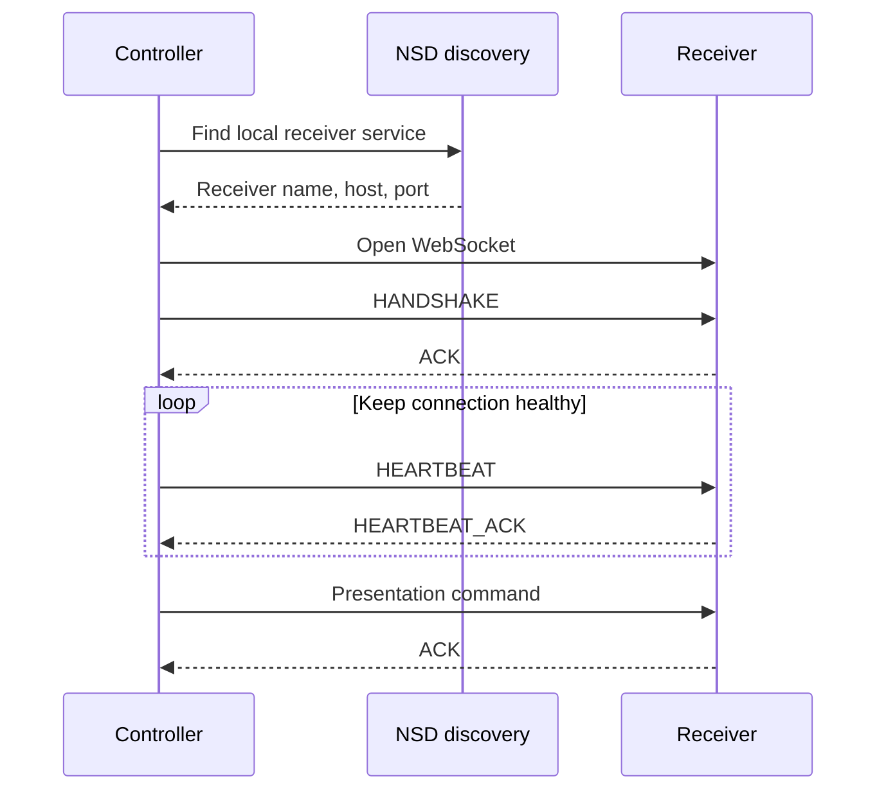

# Phase 1 Summary (Historical)

This file records the early protocol-and-connection milestone. Its original implementation checklist described a prototype snapshot and is not an accurate description of the current app. In particular, the controller is no longer an IP-only skeleton, the receiver renders song lyrics/media rather than raw messages, and NSD discovery is integrated.

## Original milestone

Phase 1 established the initial local-network connection between a phone controller and an Android TV receiver using WebSocket, receiver discovery, acknowledgements, heartbeat traffic, and reconnect behavior.

The early milestone's principal workflow was:

This is a historical view, not the whole current product. The current flow
adds a local song catalog and editor, compact slide navigation after initial
`DISPLAY`, receiver-hosted media upload and playback, templates, independent
render layers, and blank-on-connect recovery. The initial connection shell
grew into two app roles: the phone owns song authoring and operator state; the
TV owns only its active display state and uploaded media cache.

## Milestone responsibilities

- **Controller milestone:** provide a stable active-client connection, expose
  connected/disconnected status, discover a receiver or accept a manual host,
  send a command, and interpret an acknowledgement.
- **Receiver milestone:** listen for the controller, parse a small JSON
  envelope, perform a visible state transition, and answer heartbeats and
  commands.
- **Shared contract:** keep command names, timestamps, and basic message
  serialization consistent while allowing optional fields to be added later.

What Phase 1 did *not* establish was song authoring, reliable media streaming,
templates, independent layer semantics, cross-device cache management, or
device-specific visual parity. Those are tracked as later/current work in
[PROJECT_PLAN.md](PROJECT_PLAN.md) and validated against hardware using
[DEVELOPMENT.md](DEVELOPMENT.md).

## Current documentation

Use these files for current behavior and validation steps:

- [README.md](README.md) — current feature overview and validation status.
- [PROTOCOL.md](PROTOCOL.md) — protocol v2 messages, layers, handshake, and media transport.
- [DEVELOPMENT.md](DEVELOPMENT.md) — build workflow and real-device test checklist.
- [PROJECT_PLAN.md](PROJECT_PLAN.md) — implemented scope and remaining verification.
- [QUICK_REFERENCE.md](QUICK_REFERENCE.md) — ports, commands, and log filters.

## Historical test items that remain relevant

- Verify connection and recovery on a phone and TV on the same Wi-Fi and phone hotspot.
- Exercise rapid next/previous/jump navigation.
- Keep a session running long enough to check reconnect and battery behavior.
- Check discovery and manual-IP fallback on networks with multicast restrictions.

These are manual hardware checks, not claims that they have already passed. Current acceptance criteria are tracked in [DEVELOPMENT.md](DEVELOPMENT.md).
