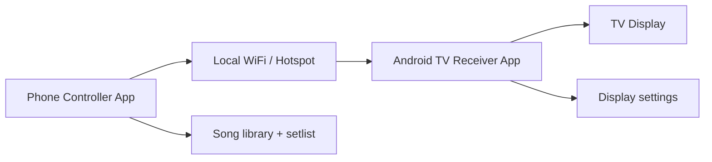

# Mobile Lyrics Presenter for Choirs - Build Plan

This document defines the phased delivery plan for building the Android TV lyric presenter system. It is intentionally aligned with the real-world church-use workflow: a phone acts as the remote, and an Android TV acts as the display.

## Goals

- Build a reliable local presentation system that works on Android TV
- Keep setup simple: no laptop or desktop required
- Use the phone as the live remote control for slides
- Work on the same WiFi network or a phone hotspot
- Keep the app fully usable offline without internet access

## Non-goals for MVP

The MVP intentionally excludes:

- Google Cast fallback
- FreeShow import
- stage-view multi-operator support
- cloud sync or remote hosting

## Architecture summary

## Project constraints

- Must work on as many Android TV devices as possible
- No manual IP entry when discovery works
- No internet requirement for normal operation
- must feel responsive for worship and rehearsal use
- network interruptions should be handled gracefully

## MVP feature checklist

### Controller app
- [ ] Song library: create, edit, delete songs
- [ ] Slide editor: split song text into slides by section
- [ ] Setlist builder: queue songs in order
- [ ] Live control: next, previous, jump, black, clear
- [ ] Receiver discovery: scan local network
- [ ] Connection health indicator

### Receiver app
- [ ] Full-screen lyric display
- [ ] Adjustable font, size, colors, and background settings
- [ ] Black screen state
- [ ] Auto-listen for controller connections
- [ ] Reconnect handling after brief WiFi problems

### Shared / infrastructure
- [ ] NSD/mDNS receiver discovery
- [ ] WebSocket protocol with ack, heartbeat, and recovery
- [ ] Local storage for songs and setlists
- [ ] Connection pairing or simple device selection

## Delivery phases

## Phase 1 — Protocol and connection foundation

This is the highest-risk phase because the app must connect reliably over local WiFi before any song features are added.

### Phase 1 goals
- establish the communication contract between phone and TV
- prove the controller can connect to the receiver on the same network
- prove the receiver can show live updates
- handle reconnects and keep-alive traffic

### Deliverables

#### 1.1 Protocol definition
- Define JSON message set for navigation actions and state updates
- Document receiver acknowledgements and heartbeat flow
- Define reconnect expectations and invalid-connection handling

#### 1.2 TV receiver baseline
- Minimal app starts and shows a screen
- WebSocket listener is running on port 8765
- Incoming message text is rendered to the display
- App shows a connection status indicator

#### 1.3 Phone controller baseline
- App can open a WebSocket to a receiver host
- User can send a hardcoded message to test the connection
- App exposes a next/previous testing interface

#### 1.4 Network discovery
- Use NSD/mDNS to discover receiver devices
- Surface discovered receivers in a list for the operator
- Remove the need for manual host entry in the normal case

#### 1.5 Reliability layer
- Add heartbeat messages at a fixed interval
- Handle closed sockets and dropped connections
- Retry connection with exponential backoff
- Restore display state after reconnection

### Acceptance criteria
- controller can successfully connect to receiver on same local network
- `NEXT_SLIDE` message updates displayed text on the receiver
- receiver acknowledges commands successfully
- heartbeat prevents stale sockets from going unnoticed
- reconnect works after a short WiFi interruption

## Phase 2 — Song data model and editing

Once the connection layer is proven, the app can start modeling lyrics as meaningful data rather than raw strings.

### Phase 2 goals
- represent songs as structured data
- support editing and persistence locally
- split lyrics into sections and slides in a natural way

### Deliverables

#### 2.1 Song and slide data model
- `Song` entity with title, author, key, notes, and metadata
- `Section` entity for verse, chorus, bridge, intro, outro
- `Slide` entity representing the actual displayed lyric block

#### 2.2 Local storage
- Use Room or a lightweight local database for persistence
- Save song library and setlist data offline
- Support add, update, delete, and reorder operations

#### 2.3 Slide editing
- Auto-split lyrics by blank lines or section markers
- Allow manual slide adjustments and reorder
- Preserve section naming like Verse 1, Chorus, Bridge

#### 2.4 Setlist builder
- Build a queue of songs for a service or rehearsal
- Reorder songs by drag or move operations
- Simple service flow from first song to last

### Acceptance criteria
- user can create a song and save it locally
- lyrics can be split into multiple slides without losing structure
- setlist can be reordered and persisted
- app still works fully offline

## Phase 3 — Live control UI

This phase is about the on-stage control experience: the operator must be able to run the presentation quickly and confidently.

### Deliverables

- current slide indicator
- next/previous buttons
- jump-to-slide menu or list
- preview of upcoming slide text
- setlist queue visible during service
- black screen and clear state controls

### Acceptance criteria
- operator can run a service with minimal taps
- live UI stays readable even in a fast-moving worship flow
- slide changes are visible almost instantly on the TV

## Phase 4 — TV display polish

The TV should feel like a proper lyric screen rather than a raw debug view.

### Deliverables

- full-screen rendering
- large text sizing tuned for TV distances
- adjustable font, color, and background theme
- support for background images and accent colors
- smooth transitions between slide changes

### Acceptance criteria
- lyrics are readable from the typical seating distance
- theme settings are persisted on the TV app
- black screen feels immediate and intentional

## Phase 5 — Reliability and compatibility pass

This phase validates the real requirement: it must work on actual Android TV devices in real spaces.

### Testing goals
- test on several Android TV models and Android versions
- verify behavior on phone hotspot networks
- test repeated rapid control taps
- validate reconnect behavior under flaky WiFi conditions

### Acceptance criteria
- no obvious compatibility breakage across common Android TV devices
- WiFi interruptions do not leave the app permanently stuck
- controls remain responsive during rapid use

## Phase 6 — Optional future additions

These features are outside the MVP but may be valuable later.

- Google Cast fallback for TVs where sideloading is not possible
- FreeShow import for easy song migration
- multi-operator support
- singer stage view

## Milestones

### Milestone 1 — first connection works
Status: phase 1 complete

- controller connects to receiver
- messages flow across the network
- connection is stable enough for a rehearsal demo

### Milestone 2 — demo song playback works
Status: phase 2 & 3 complete

- song library exists
- setlist is usable
- actual lyrics render on TV display

### Milestone 3 — church-ready usage test
Status: phase 4 & 5 complete

- layout is readable on TV
- user can operate it with confidence
- reconnects and hotspots are tested

## Risk register

### Risk 1: WiFi reliability
Mitigation: heartbeat, exponential retry, and sending last state on reconnect.

### Risk 2: Android TV compatibility
Mitigation: keep receiver simple, avoid platform-specific assumptions, test on multiple devices.

### Risk 3: Discovery complexity
Mitigation: implement NSD with fallback to manual IP entry if discovery fails.

### Risk 4: Use-case complexity of slide editing
Mitigation: keep the editor simple and focused on the common church workflow before more advanced features.

## Suggested implementation order

1. Define protocol and message schema
2. Build receiver with raw message display
3. Build controller with connect and next/prev buttons
4. Add discovery and heartbeats
5. Add reconnect logic and state resync
6. Build local song model and Room database
7. Build setlist editor and live control screen
8. Add TV display polish and theme settings
9. Run compatibility and hotspot tests

## Summary

The project should be built in short, testable phases so the most risky technical part — local network reliability and Android TV compatibility — is solved before adding song management and display polish. That order reduces the chance of building a large UI around a fragile protocol.
