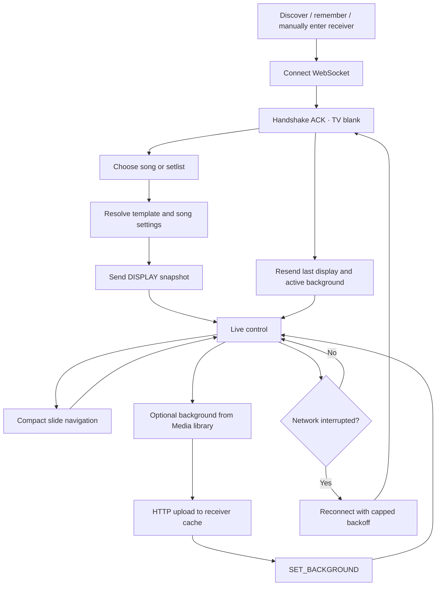
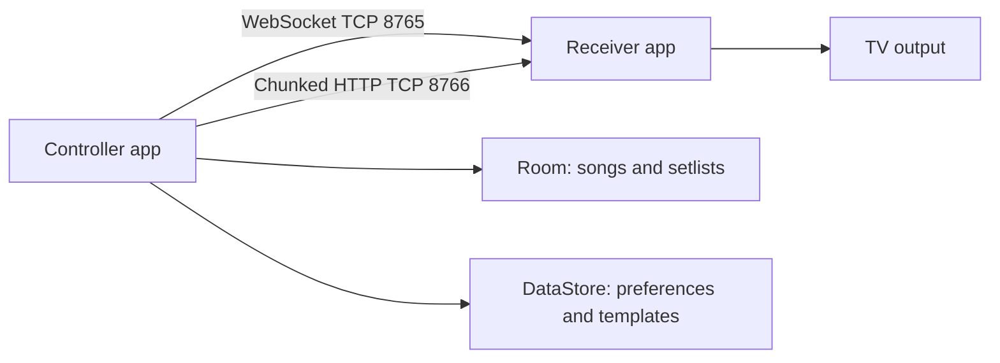

# Project Plan and Status

This plan tracks the phone controller, Android TV receiver, and their shared local-network protocol. Feature checkmarks describe implemented code; they do not imply that physical-device acceptance testing has passed.

## Product goals

- Operate a lyric presentation from a phone on the same local network as an Android TV.
- Keep song/setlist data local and work without cloud services.
- Make lyric navigation immediate and keep background media independent from lyric slides.
- Recover from short network interruptions without losing the current presentation state.

## Product workflow

The flow distinguishes user content from device output. Songs and folders are
local catalog data, templates are reusable style descriptions, and receiver
layer state is the live output configuration. A connection handshake resets
the TV to black; after the ACK, the controller restores the operator's intended
state. In normal navigation only the current slide changes.

## Current implementation

### Controller

- [x] Local song library, editing, slide splitting, TXT import, and setlists.
- [x] Fuzzy song search, title/author/recency sorting, and persistent folders for organizing songs.
- [x] NSD discovery, manual IP entry, remembered receiver endpoint, and connection state.
- [x] Foreground connection service with heartbeat, ping, reconnect, and saved presentation restore.
- [x] Optimistic next/previous/jump state and compact slide-navigation commands.
- [x] Live template/style controls, collapsible template options, color picker, and 16:9 creator preview.
- [x] Custom/built-in template persistence and media library/upload controls.
- [x] Issue/connection messages only; successful presentation changes do not create toast messages, which dismiss after one second.

### Receiver

- [x] Full-screen lyric display; connection/address status only while disconnected.
- [x] Pure-black `BLANK` state on each WebSocket handshake.
- [x] Independent lyrics, background, and overlay state, plus a separate black override.
- [x] Receiver HTTP media upload/cache server with byte-range streaming.
- [x] Coil image display, Media3 video playback, fit options, and playback controls.
- [x] Background state retained across lyric changes and black/clear-lyrics commands.
- [x] Preferred 4K display mode when exposed by the device.

### Shared / protocol

- [x] Backward-compatible protocol v2 handshake metadata, ACK state, layer commands, media messages, templates, and style updates.
- [x] Shared song/slide/template/message models and protocol serialization tests.

## Remaining verification

- [ ] Build the complete project in the intended Android/Gradle environment.
- [ ] Measure visible slide latency on a phone and TV on a normal Wi-Fi network.
- [ ] Test 1080p JPEG and H.264 video uploads across two devices; verify byte-range seeking.
- [ ] Exercise HEVC input and confirm the device either plays it or reports a clear, actionable error.
- [ ] Run reconnect and background playback soak tests on physical devices.
- [ ] Verify TV-specific 4K mode, D-pad behavior, and Telugu glyph line-height.
- [ ] Inspect memory/player lifecycle behavior during extended media switching.

## Architecture

The receiver hosts media rather than sending bulk media bytes through the command socket. For the implementation rationale and device test steps, see [DEVELOPMENT.md](DEVELOPMENT.md).

## Data ownership and persistence

| Data | Owner | Persistence | Sent to receiver? |
| --- | --- | --- | --- |
| Song title, sections, slide text | Controller | Room | Yes, in `DISPLAY` when a song is loaded/restored |
| Song folders and setlists | Controller | Room | Setlist selection resolves to songs; folder organization is not needed by TV |
| Built-in templates | Shared source | Compiled into app | Full selected template can be sent |
| Custom templates, colors, receiver choice | Controller | DataStore | Only the selected style/receiver endpoint is used in commands |
| Picked local content URI | Controller | Persisted picker access where available | No; uploader reads it locally |
| Uploaded media file | Receiver | App cache | Addressed through `mediaId` and receiver LAN URL |
| Current TV slide and layer state | Receiver while running; controller recovery snapshot | In-memory receiver; controller persists recovery data | ACK reports receiver-confirmed state |

The receiver does not open the controller's Room database or DataStore. The
controller sends enough rendering information for the receiver to act without
copying the controller's template catalog.

## Feature boundaries

- **Library:** supports local create/edit/import, approximate search, sorting,
  folders, and setlists. It has no cloud account or cross-device sync.
- **Live control:** sends the initial display state, small navigation commands,
  layer changes, and template/style updates. Connection/recovery feedback is
  surfaced separately from successful presentation actions.
- **Media:** transfer is phone-to-TV using chunked HTTP; playback is TV-local
  via a receiver URL. This keeps large files out of the WebSocket channel.
- **Receiver:** renders background, lyrics, overlay dim, and black override as
  independent state. A TV-specific codec or display mode remains hardware
  dependent.

## Risks and follow-up

- **TV codec differences:** hardware decoders vary by model; surface playback errors and validate representative devices.
- **Local network isolation:** guest Wi-Fi may block peer traffic or multicast; manual IP and phone hotspot are fallbacks.
- **Android background limits:** foreground service and wake/Wi-Fi locks improve resilience, but OEM power settings may still require user configuration.
- **Reclaimable cache:** Android may clear app cache; media may need to be uploaded again if an asset is unavailable.
- **Preview parity:** the live preview uses the controller's local display state; visually compare against real output for TV-specific rendering differences.

## Future ideas (not current commitments)

- Optional low-rate TV snapshot mirror for preview verification.
- Media transcoding to a conservative TV-compatible profile.
- FreeShow import, stage view, multi-operator support, or cloud sync.
