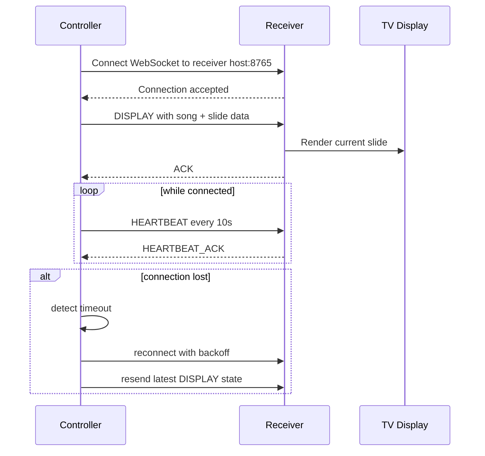

# WebSocket Protocol for Mobile Lyrics Presenter

This document defines the local network protocol used between the phone controller app and the Android TV receiver app.

## Overview

The protocol is intentionally simple and lightweight so it can work well on a local WiFi network and on phone hotspots without relying on any internet service.

The controller app sends commands such as `NEXT_SLIDE`, `PREV_SLIDE`, `JUMP_SLIDE`, and `BLACK_SCREEN`. The receiver app processes those events and updates the displayed lyric slide. The receiver also sends acknowledgements and heartbeat responses so the controller can keep the connection healthy.

## Protocol characteristics

- JSON over WebSocket
- Port: 8765
- Local network only
- Plain text payloads, easy to inspect in logs
- Controller is the active client; receiver is the server
- Optional network discovery via NSD/mDNS to avoid manual IP entry

## Connection lifecycle



## Message envelope

All messages are JSON objects and include a type field. The payload may vary by message type, but the shape is always consistent enough for a simple parser.

```json
{
  "type": "NEXT_SLIDE",
  "timestamp": 1720000000000
}
```

### Handshake and connection state (protocol version 2)

The WebSocket upgrade remains unchanged. On every successful connection, the
receiver clears the visible output to pure black and sends a successful ACK for
`HANDSHAKE`. It includes `protocolVersion`, the embedded media HTTP port, the
current `layerState`, and optional `screenWidthDp` / `screenHeightDp` values for
accurate controller previews. A controller restores content by re-sending its
latest state after receiving this ACK. Older clients may ignore these additional
ACK fields. A receiver must remain black until it receives a display, media, or
show command; connection status and address UI is shown only while disconnected.

```json
{"type":"ACK","receivedMessageType":"HANDSHAKE","success":true,
 "protocolVersion":2,"mediaPort":8766,"screenWidthDp":1920,"screenHeightDp":1080,
 "layerState":{"background":false,"lyrics":false,"overlay":false},
 "timestamp":1720000000000}
```

All ACKs may include `screenState` (`BLANK`, `BLACK`, or `CONTENT`) and a
`layerState` object. These additions do not change the legacy `success`,
`currentSlide`, or `error` fields; older ACK readers may ignore them.

## Standard message types

### 1. `NEXT_SLIDE`
Moves to the next slide in the current song.

```json
{
  "type": "NEXT_SLIDE",
  "timestamp": 1720000000000
}
```

### 2. `PREV_SLIDE`
Moves to the previous slide in the current song.

```json
{
  "type": "PREV_SLIDE",
  "timestamp": 1720000000000
}
```

### 3. `JUMP_SLIDE`
Jumps directly to a specific slide index.

```json
{
  "type": "JUMP_SLIDE",
  "slideIndex": 2,
  "timestamp": 1720000000000
}
```

### 4. `DISPLAY`
Provides the current song payload and slide list. This is typically sent when the operator connects or changes song/setlist.

```json
{
  "type": "DISPLAY",
  "songId": "song-24",
  "songTitle": "Amazing Grace",
  "currentSlide": 0,
  "totalSlides": 3,
  "slides": [
    { "index": 0, "content": "Amazing grace, how sweet the sound" },
    { "index": 1, "content": "I once was lost, but now am found" },
    { "index": 2, "content": "Was blind, but now I see" }
  ],
  "timestamp": 1720000000000
}
```

### 5. `BLACK_SCREEN`
Tells the receiver to hide all lyrics and show a black display.

```json
{
  "type": "BLACK_SCREEN",
  "timestamp": 1720000000000
}
```

### 6. `CLEAR_SCREEN`
Clears slide text, removes a black override, and keeps background and overlay
layers unchanged. Its ACK reports `screenState=CONTENT` with `layerState.lyrics=false`.

```json
{
  "type": "CLEAR_SCREEN",
  "timestamp": 1720000000000
}
```

### 7. `ACK`
Acknowledges a command after the receiver has processed it.

```json
{
  "type": "ACK",
  "receivedMessageType": "NEXT_SLIDE",
  "success": true,
  "currentSlide": 1,
  "timestamp": 1720000000000
}
```

When an error occurs, the receiver may send a failed ACK:

```json
{
  "type": "ACK",
  "receivedMessageType": "JUMP_SLIDE",
  "success": false,
  "error": "Slide index 99 out of bounds.",
  "timestamp": 1720000000000
}
```

### 8. `HEARTBEAT`
Sent periodically by the controller to confirm the connection is still alive.

```json
{
  "type": "HEARTBEAT",
  "timestamp": 1720000000000
}
```

### 9. `HEARTBEAT_ACK`
Responded by the receiver to indicate it is still available.

```json
{
  "type": "HEARTBEAT_ACK",
  "timestamp": 1720000000000
}
```

## State model

The receiver should maintain the following high-level state:

- `connected`: whether the WebSocket is open
- `screenState`: `BLANK`, `CONTENT`, or `BLACK`
- `layerState`: independent `background`, `lyrics`, and `overlay` visibility
- `songId`: current song identifier
- `currentSlide`: current slide index
- `totalSlides`: total number of slides in the active song
- `lastHeartBeat`: time of last kept-alive response

A simple state diagram:

```mermaid
stateDiagram-v2
    [*] --> Disconnected
    Disconnected --> Connected: WebSocket open
    Connected --> Blank: WebSocket open / HANDSHAKE
    Blank --> Content: DISPLAY or SET_BACKGROUND or show command
    Content --> BlackScreen: BLACK_SCREEN (background state retained)
    BlackScreen --> Content: CLEAR_SCREEN (lyrics cleared; background retained)
    Content --> Blank: CLEAR_ALL
    Blank --> Disconnected: connection lost
    Content --> Disconnected: connection lost
    BlackScreen --> Disconnected: connection lost
```



`Blank` and `BlackScreen` are distinct states. `Blank` is the receiver's
initial pure-black output after every successful WebSocket open. The receiver
must hide its address/listening UI while connected and must not restore old
output by itself. The controller can restore its last persisted presentation
after the `HANDSHAKE` ACK. `BlackScreen` is an operator override sent with
`BLACK_SCREEN`; it covers the output but retains background media and playback
state.

## Independent output layers (protocol v2)

The receiver maintains independent background, lyrics, and dim-overlay layers.
`NEXT_SLIDE`, `PREV_SLIDE`, `JUMP_SLIDE`, and `DISPLAY` update lyrics and style;
they do not clear an active background. A legacy `DISPLAY` may update a
background only when it includes a usable `backgroundMediaUrl`. If the field is
omitted, the current media background is kept. New controller implementations
send media changes using `SET_BACKGROUND` and `CLEAR_BACKGROUND`.

- `SET_BACKGROUND` replaces the background layer. It carries `mediaId`,
  `mediaType`, optional URL, fit (`FILL`, `FIT`, `STRETCH`), loop, and mute.
- `CLEAR_BACKGROUND` removes only the media background.
- `CLEAR_LYRICS` removes only slide text.
- `CLEAR_OVERLAY` removes only the dim layer.
- `CLEAR_SCREEN` clears slide text and returns `screenState=CONTENT`; it keeps
  background and overlay state.
- `BLACK_SCREEN` covers the rendered output in black without deleting any
  layer state. `CLEAR_SCREEN` removes this override while leaving lyrics empty.
- `CLEAR_ALL` clears background, lyrics, and overlay and returns to `BLANK`.

Every command ACK may report the complete current `layerState`. A true
`background` value means the media layer remains active even while the black
override covers it. Slide changes must not release or recreate an unchanged
video player.

## Receiver behavior rules

The receiver should:

- validate incoming JSON before applying state changes
- reject invalid `slideIndex` values
- ignore malformed `HEARTBEAT` data but still keep the socket alive
- respond with `ACK` for successfully processed commands
- respond with `HEARTBEAT_ACK` for valid heartbeats
- preserve the current song state across a brief connection interruption
- begin in `BLANK` after each WebSocket open and let the controller restore
  state only after the successful handshake ACK
- preserve background media across lyric changes, black overrides, and
  `CLEAR_SCREEN`; remove it only for `CLEAR_BACKGROUND` or `CLEAR_ALL`

## Controller behavior rules

The controller should:

- maintain a local copy of the current song and slide state
- send `DISPLAY` before the first slide is sent or after a reconnect
- resend the latest `DISPLAY` after a reconnect to restore state
- retry with exponential backoff if the connection is lost
- log connection changes but keep the UI responsive

## Reconnect and recovery behavior

If the socket closes unexpectedly, the controller should reconnect using exponential backoff.

Suggested pattern:

- 1 second
- 2 seconds
- 4 seconds
- 8 seconds
- 16 seconds
- then continue capped at 16 seconds or continue growth depending on product needs

After reconnect, the controller should send the current song state again so the TV resumes the same slide without visual jumpiness.

## Discovery and pairing model

The controller may discover a receiver using NSD/mDNS and then connect to it directly by host and port. It should not depend on the user typing an IP address when discovery works.

Typical discovery service name:

- `_lyrics_presenter._tcp`

A discovered receiver may expose:

- service name
- host address
- port number
- optional user-friendly display name

## Error handling expectations

Examples of expected receiver-side handling:

- missing `type` field: ignore or reject
- `JUMP_SLIDE` with index outside range: `ACK` with `success: false`
- non-JSON payload: reject and log
- repeated heartbeat timeout: mark as disconnected and retry connection

## Versioning and future compatibility

This protocol is intentionally simple and versioned implicitly by the `type` names. Future extensions should avoid breaking the format for older clients.

Recommended rules:

- keep `type` values stable and explicit
- add new optional fields without removing old ones
- use `ACK` to reject incompatible commands when necessary

## Example full command sequence

```json
// 1. Controller sends display state
{
  "type": "DISPLAY",
  "songId": "song-11",
  "songTitle": "Grace to Grace",
  "currentSlide": 0,
  "totalSlides": 2,
  "slides": [
    { "index": 0, "content": "Grace to grace, day by day" },
    { "index": 1, "content": "Your mercy is new every morning" }
  ],
  "timestamp": 1720000000000
}
```

```json
// 2. Receiver acknowledges
{
  "type": "ACK",
  "receivedMessageType": "DISPLAY",
  "success": true,
  "currentSlide": 0,
  "timestamp": 1720000000000
}
```

```json
// 3. Controller advances
{
  "type": "NEXT_SLIDE",
  "timestamp": 1720000000000
}
```

```json
// 4. Receiver replies
{
  "type": "ACK",
  "receivedMessageType": "NEXT_SLIDE",
  "success": true,
  "currentSlide": 1,
  "timestamp": 1720000000000
}
```

## Version 2 optional commands

These additions preserve the existing JSON envelope and are safe for older
receivers to ignore. Controllers should inspect the handshake version before
using optional capabilities.

```json
{"type":"SET_BACKGROUND","mediaId":"abc123","mediaType":"VIDEO","mediaUrl":"http://192.168.1.12:8766/media/abc123","fit":"FILL","loop":true,"muted":true,"timestamp":1720000000000}
{"type":"CLEAR_BACKGROUND","timestamp":1720000000000}
{"type":"CLEAR_LYRICS","timestamp":1720000000000}
{"type":"CLEAR_OVERLAY","timestamp":1720000000000}
{"type":"CLEAR_ALL","timestamp":1720000000000}
{"type":"APPLY_TEMPLATE","template":{"id":"builtin-classic","name":"Classic White on Black","isDefault":true,"isBuiltIn":true,"fontFamily":"SansSerif","fontSize":48,"bold":false,"italic":false,"textColor":"#FFFFFFFF","horizontalAlignment":"center","verticalAlignment":"center","lineSpacing":1.25,"backgroundType":"SOLID","backgroundColor":"#FF000000","mediaFitMode":"FILL","overlayDimPercent":0,"paddingDp":40,"marginDp":0,"backgroundMediaUrl":"http://192.168.1.12:8766/media/abc123"},"timestamp":1720000000000}
{"type":"UPDATE_STYLE","textColor":"#FFFFFFFF","bgColor":"#FF000000","backgroundAlpha":40,"timestamp":1720000000000}
{"type":"MEDIA_READY","mediaId":"abc123","url":"http://192.168.1.12:8766/media/abc123","timestamp":1720000000000}
{"type":"MEDIA_ERROR","mediaId":"abc123","reason":"Unsupported media type","timestamp":1720000000000}
```

The receiver hosts a local HTTP endpoint on port 8766. The controller streams
a chosen image/video with `POST /media` using chunked transfer encoding and a
media `Content-Type`. A successful response contains `mediaId`, relative `url`,
and `type`; the receiver also emits `MEDIA_READY`. `GET /media/{mediaId}`
supports byte ranges for video seeking. The endpoint rejects non-media types
and files over 2 GiB. Storage or decoding errors should be reported using
`MEDIA_ERROR` and a failed `ACK` where possible.

`SET_BACKGROUND` activates the media layer independently of lyrics.
`CLEAR_BACKGROUND`, `CLEAR_LYRICS`, `CLEAR_OVERLAY`, and `CLEAR_ALL` affect only their named
layers (all layers for `CLEAR_ALL`). `BLACK_SCREEN` remains an immediate black
override. ACKs may include `layerState` (`background`, `lyrics`, `overlay`)
and `screenState`; old ACK readers can ignore both fields.

Media fit values are `FILL`, `FIT`, and `STRETCH`. Video controls use
`VIDEO_PLAY`, `VIDEO_PAUSE`, `VIDEO_RESTART`, `VIDEO_LOOP { enabled }`, and
`VIDEO_MUTE { enabled }`. Defaults are fill, loop enabled, muted, and no dim.
Because the outer envelope already uses `type` for the command name,
`SET_BACKGROUND` uses the optional `mediaType` field for `IMAGE` or `VIDEO`.
When available, the controller should include the absolute `mediaUrl` in
`SET_BACKGROUND`, and `backgroundMediaUrl` in `DISPLAY.displaySettings` or an
`APPLY_TEMPLATE.template`. These optional fields use the receiver host selected
for the active WebSocket connection, so media playback is routed over the same
network interface as control traffic on multi-interface devices. Receivers may
fall back to their local address when older controllers omit these fields.
`DISPLAY.displaySettings.textPaddingDp` is an optional safe-area padding value;
older receivers ignore it and older messages default to the standard padding.

## Summary

The protocol is intentionally small and built around local network reliability. It supports display state, independent background/lyric/overlay layers, self-contained templates, media transfer, black screen, and heartbeats.
