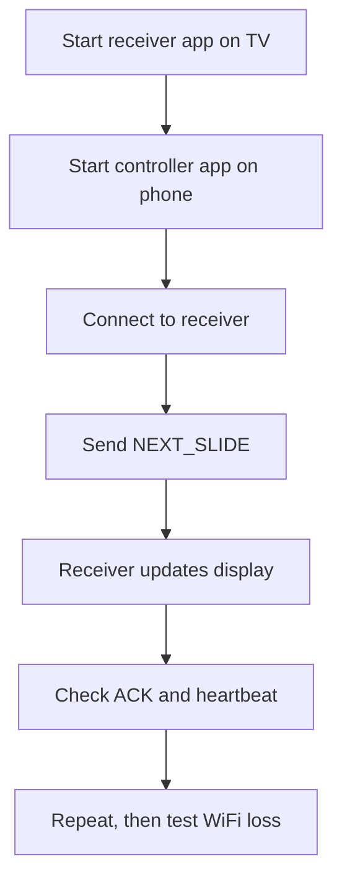

# Quick Reference Guide

This file is the short-form developer cheat sheet for the Mobile Lyrics Presenter project. It gathers the most useful build, debugging, and protocol commands in one place.

## Project map

```text
d:\slideshow
├── controller/app/src/main/java/com/lyricsapp/controller
│   ├── MainActivity.kt
│   ├── WebSocketClientManager.kt
│   └── DiscoveryManager.kt
├── receiver/app/src/main/java/com/lyricsapp/receiver
│   ├── MainActivity.kt
│   ├── SimpleWebSocketServer.kt
│   └── WebSocketServerManager.kt
├── shared/src/main/java/com/lyricsapp/shared
│   └── Message.kt
├── PROTOCOL.md
├── PROJECT_PLAN.md
├── DEVELOPMENT.md
├── QUICK_REFERENCE.md
├── README.md
├── build.gradle.kts
├── settings.gradle.kts
└── .gitignore
```

## Core project commands

### Build everything

```bash
cd d:\slideshow
./gradlew build
```

### Clean and rebuild

```bash
cd d:\slideshow
./gradlew clean build
```

### Build only the receiver app

```bash
cd d:\slideshow
./gradlew :receiver:app:build
```

### Build only the controller app

```bash
cd d:\slideshow
./gradlew :controller:app:build
```

### Install both apps to connected devices

```bash
cd d:\slideshow
./gradlew installDebug
```

### Install a specific app

```bash
cd d:\slideshow
./gradlew :receiver:app:installDebug
./gradlew :controller:app:installDebug
```

## Useful adb commands

```bash
adb devices
adb logcat
adb logcat -s "WebSocketClient" "WebSocketServer" "DiscoveryManager"
adb uninstall com.lyricsapp.receiver
adb uninstall com.lyricsapp.controller
```

## Log filters

Use these to narrow debugging output:

```bash
adb logcat -s "WebSocketClient"
adb logcat -s "WebSocketServer"
adb logcat -s "DiscoveryManager"
adb logcat -s "MainActivity"
```

## Message templates

### Next slide

```json
{
  "type": "NEXT_SLIDE",
  "timestamp": 1720000000000
}
```

### Previous slide

```json
{
  "type": "PREV_SLIDE",
  "timestamp": 1720000000000
}

### Jump to a specific slide

```json
{
  "type": "JUMP_SLIDE",
  "slideIndex": 2,
  "timestamp": 1720000000000
}
```

### Black screen

```json
{
  "type": "BLACK_SCREEN",
  "timestamp": 1720000000000
}
```

### Clear screen

```json
{
  "type": "CLEAR_SCREEN",
  "timestamp": 1720000000000
}
```

### Full display state

```json
{
  "type": "DISPLAY",
  "songId": "song-24",
  "songTitle": "Amazing Grace",
  "currentSlide": 0,
  "totalSlides": 3,
  "slides": [
    { "index": 0, "content": "Amazing grace, how sweet the sound" },
    { "index": 1, "content": "I once was lost, but now am found" },
    { "index": 2, "content": "Was blind, but now I see" }
  ],
  "timestamp": 1720000000000
}
```

### Receiver acknowledgement

```json
{
  "type": "ACK",
  "receivedMessageType": "NEXT_SLIDE",
  "success": true,
  "currentSlide": 1,
  "timestamp": 1720000000000
}
```

### Heartbeat

```json
{
  "type": "HEARTBEAT",
  "timestamp": 1720000000000
}
```

### Heartbeat ack

```json
{
  "type": "HEARTBEAT_ACK",
  "timestamp": 1720000000000
}
```

## Fast workflow for local testing



## Expected validation checklist

### Basic connection
- [ ] receiver app starts and waits for a controller
- [ ] controller app connects to the receiver
- [ ] receiver shows connected state
- [ ] controller shows connected state

### Message flow
- [ ] `NEXT_SLIDE` reaches the TV
- [ ] `PREV_SLIDE` reaches the TV
- [ ] `BLACK_SCREEN` hides the lyrics
- [ ] `CLEAR_SCREEN` restores the lyrics

### Recovery flow
- [ ] disconnect detection triggers quickly
- [ ] heartbeat remains healthy during a normal session
- [ ] reconnect works after a brief WiFi interruption
- [ ] current state is restored after reconnect

## Troubleshooting

### Apps will not connect
- confirm both devices are on the same local network
- verify the receiver IP is correct if using manual connect
- ensure receiver app is still running
- check logs for socket errors

### Messages do not display
- confirm the socket is open
- verify the JSON payload is valid and includes a recognized `type`
- inspect the receiver logs for parse issues

### Discovery fails
- verify the receiver service is being published
- check that both devices are on the same WiFi segment
- use manual connection as a fallback while debugging the discovery logic

### Reconnect loops too aggressively
- check whether the heartbeat timeout is too strict
- review the backoff logic in the controller
- ensure the socket is actually closed before trying again

## Device and environment notes

- Prefer to test with one real Android TV and one real phone if possible
- Phone hotspot mode is a critical test because many churches do not have robust venue WiFi
- Keep a small set of sample lyrics ready to exercise slide changes quickly during testing

## Common file references

- `PROTOCOL.md` — the network protocol contract
- `PROJECT_PLAN.md` — phases and milestones
- `DEVELOPMENT.md` — build and testing workflow
- `README.md` — product overview and project context

## Suggested implementation order

1. receiver app starts and listens on port 8765
2. controller app can connect to a receiver
3. next/previous controls update the TV state
4. heartbeat and reconnect logic are stable
5. discovery is enabled without requiring manual IP entry
6. song and setlist data is added locally
7. display theme and TV polish are added

## Summary

The most important thing to keep in mind is the product requirement: a phone must reliably control a TV lyric display over the local network. Build for network stability first, then add features that make worship and rehearsal usage smooth.
