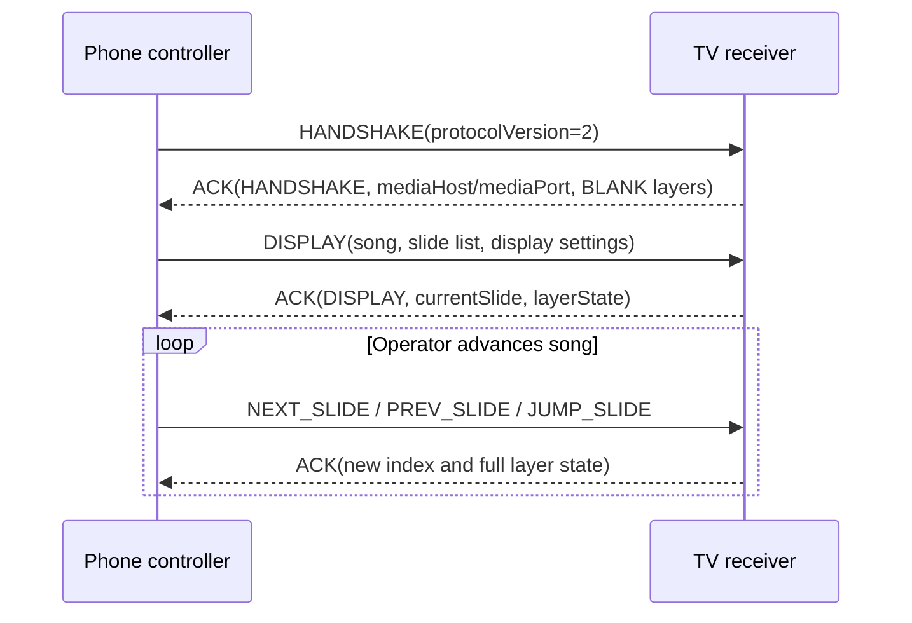
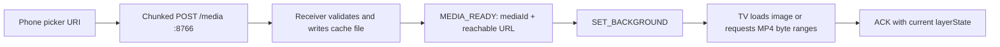
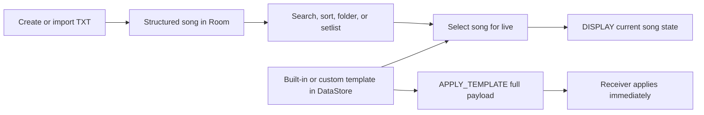

# Quick Reference

Short commands and protocol notes for the current controller / receiver / shared project. See [PROTOCOL.md](PROTOCOL.md) for the complete contract and [DEVELOPMENT.md](DEVELOPMENT.md) for device validation.

## Project map

```text
controller/app/src/main/java/com/lyricsapp/controller/
  MainActivity.kt                 UI, routing, previews
  ConnectionKeepAliveService.kt   foreground WebSocket owner
  WebSocketClientManager.kt       socket, heartbeat, reconnect
  DiscoveryManager.kt             NSD discovery
receiver/app/src/main/java/com/lyricsapp/receiver/
  MainActivity.kt                 full-screen output and display state
  SimpleWebSocketServer.kt        WebSocket server
  EmbeddedMediaServer.kt          HTTP upload and range streaming
shared/src/main/java/com/lyricsapp/shared/
  Message.kt                      protocol and presentation models
```

## Gradle commands

```bash
./gradlew build
./gradlew clean build
./gradlew :controller:app:build
./gradlew :receiver:app:build
```

Device installation is separate and changes connected devices:

```bash
./gradlew :controller:app:installDebug
./gradlew :receiver:app:installDebug
```

## Useful log filters

```bash
adb logcat -s PresentationService BackgroundLayer BlankState
adb logcat -s SlideLatency
adb logcat -s MediaServer
adb logcat -s WebSocketClient WebSocketServer DiscoveryManager
```

`SlideLatency` timestamps are diagnostic send/ACK/render measurements. A log round trip is not a substitute for measuring visible latency on two physical devices.

## Common WebSocket commands

Navigation commands are compact. The receiver moves through the slide list from the most recent `DISPLAY`.

```json
{"type":"NEXT_SLIDE","timestamp":1720000000000}
{"type":"PREV_SLIDE","timestamp":1720000000000}
{"type":"JUMP_SLIDE","slideIndex":2,"timestamp":1720000000000}
```

Load a song/display state:

```json
{
  "type":"DISPLAY",
  "songId":"song-24",
  "songTitle":"Amazing Grace",
  "currentSlide":0,
  "totalSlides":2,
  "slides":[
    {"index":0,"content":"Amazing grace, how sweet the sound"},
    {"index":1,"content":"I once was lost, but now am found"}
  ],
  "timestamp":1720000000000
}
```

### Normal live-session sequence



If the socket reconnects, expect a new handshake and blank TV output followed
by the controller resending the last display/background state. The blank is a
deliberate privacy/output-reset behavior; it is not a failed restore.

Independent layer operations:

```json
{"type":"SET_BACKGROUND","mediaId":"abc123","mediaType":"VIDEO","fit":"FILL","loop":true,"muted":true,"timestamp":1720000000000}
{"type":"CLEAR_BACKGROUND","timestamp":1720000000000}
{"type":"CLEAR_LYRICS","timestamp":1720000000000}
{"type":"CLEAR_ALL","timestamp":1720000000000}
{"type":"BLACK_SCREEN","timestamp":1720000000000}
{"type":"CLEAR_SCREEN","timestamp":1720000000000}
```

`CLEAR_SCREEN` clears lyrics and removes a black override while retaining background and overlay state. `BLACK_SCREEN` is a black override; it does not delete active layer state. `CLEAR_ALL` clears every layer.

| Operator intent | Command | Expected result |
| --- | --- | --- |
| Remove lyric text, reveal any background | `CLEAR_LYRICS` or `CLEAR_SCREEN` | Background/overlay are retained |
| Hide everything temporarily | `BLACK_SCREEN` | Pure black cover; layers remain configured |
| Remove media only | `CLEAR_BACKGROUND` | Lyrics remain visible when present |
| Start fresh / blank output | `CLEAR_ALL` | All layers cleared and output becomes black |

Use `CLEAR_SCREEN` after `BLACK_SCREEN` to remove the black override while
leaving lyric text cleared. It does not mean “delete every layer.”

## Ports and handshake

- WebSocket control: TCP `8765`.
- Receiver media HTTP server: TCP `8766`.
- Controller sends `HANDSHAKE` with `protocolVersion: 2` after the WebSocket opens.
- Receiver ACK includes `protocolVersion`, media endpoint information, `screenState`, and `layerState` when available. A newly opened session is `BLANK` until a show/display command arrives.
- Upload media with chunked `POST /media`; stream from `GET /media/{mediaId}`. Range requests support video seeking. URLs use the LAN host advertised by the active receiver connection, never `localhost`.

## Media upload path



The picker URI is phone-local, so it is only read by the uploader. For
cross-device diagnosis, check that upload and playback use the TV's advertised
LAN host, the controller can reach port `8766`, and the receiver has space in
app cache. For video seeking, a valid partial response is `206` with a
`Content-Range` header.

## Library and template workflow



Song content and folders are Room-backed. Templates, receiver preferences,
and color selections are DataStore-backed. Built-in templates may be applied
or duplicated, but only custom copies are editable/deletable.

## Quick validation

- Start the receiver; confirm its listening/address screen is visible while disconnected.
- Connect the controller; confirm the TV becomes pure black (`BLANK`).
- Send/display a song, then navigate, jump, black, and clear.
- Upload an image and video from a separate phone; verify both work with the TV's LAN IP.
- Change slides while media plays; clear background, lyrics, and all independently.
- Interrupt Wi-Fi briefly; confirm reconnect/state restore and no stale background loss.
- Confirm only connection events or issues toast; successful presentation changes stay quiet and messages disappear after one second.

## Troubleshooting

| Symptom | First checks |
| --- | --- |
| Cannot connect | Same Wi-Fi/hotspot, receiver listening, correct IP and WebSocket port `8765`. |
| Receiver not discovered | Same subnet and NSD availability; use manual IP while diagnosing. |
| Media upload/playback fails | Check handshake `mediaHost`/`mediaPort`, LAN reachability to `8766`, cleartext local HTTP access, `MediaServer` logs, and media error message. |
| Background vanishes on slide change | Check receiver layer state and `BackgroundLayer` logs; slide navigation should not clear media. |
| Reconnect does not restore | Check `PresentationService` logs, saved receiver endpoint, and last-state resend after handshake. |
| Lyrics show in the wrong place | Compare template alignment, fit, margins and the creator's 16:9 preview; validate on the target TV. |
