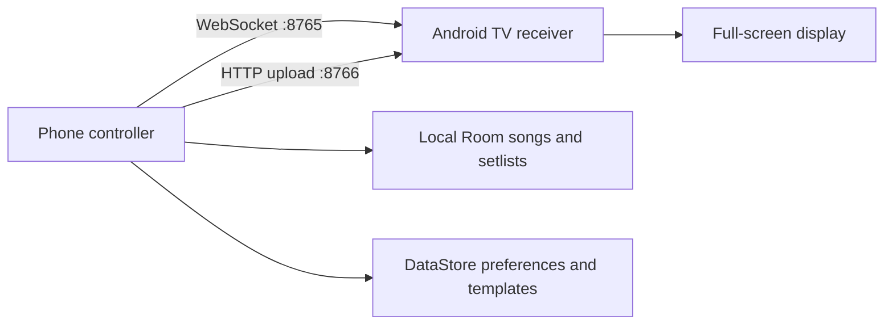
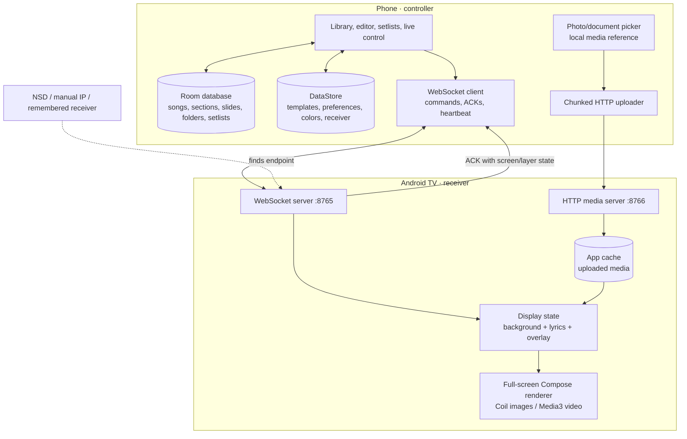
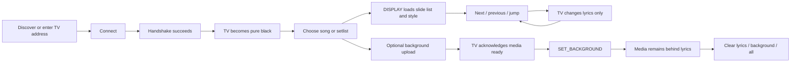

# Mobile Lyrics Presenter for Choirs

A local-network Android presentation system with a phone controller and an Android TV receiver. Songs and setlists are stored on-device. The controller sends presentation commands over WebSocket; background images and videos travel over the receiver's local HTTP media endpoint.

## Current features

### Controller

- Song library, section/slide editor, TXT import, and setlists.
- Fuzzy title/author search, configurable title/author/date sorting, and persistent song folders with move, rename, and delete actions.
- Live controls for previous, next, jump, black, clear, lyrics, and background layers.
- Receiver discovery (NSD), manual IP connection, remembered receiver, heartbeat, and automatic reconnect.
- Collapsible live-session options and template picker, leaving navigation and the slide grid accessible.
- Built-in and custom templates with typography, alignment, spacing, padding, solid/gradient backgrounds, imported-media selection, fit, dim, text shadow and outline-color setting, and per-song styling; the song creator includes a 16:9 preview.
- Text/background color picker with presets, HSV, RGB, HEX, background alpha, and saved color preferences.
- Media library uploads images/videos to the receiver over HTTP, with fit and video playback controls.
- A transient message host: connection messages and issues are shown; successful presentation changes are silent. Messages dismiss after one second.

### Receiver

- Full-screen lyrics and media output with independent background, lyrics, and overlay state.
- Pure-black blank output after each WebSocket handshake; connection/address UI appears only while disconnected.
- Background media persists through lyric navigation and can be cleared independently.
- WebSocket control on port `8765`; HTTP upload and range playback on port `8766`.
- Video playback uses Media3; images use Coil. The receiver requests a 4K display mode when supported.

### Shared and protocol

- Kotlin message/model definitions in `shared/`.
- Backward-compatible protocol v2 additions for handshake metadata, layer state, templates, styles, media, and command acknowledgements.
- See [PROTOCOL.md](PROTOCOL.md) for message shapes and state rules.

## Architecture



The receiver binds its media server to local network interfaces and advertises its reachable host in the handshake. Media URLs must use that LAN host; phone-local `content://` URIs are never sent for TV playback. Both transports are intended for a trusted local network.

## How the app is organized

The repository builds two installable Android applications plus one Android library. The controller is the operator's workspace; the receiver is a purpose-built output surface; `shared/` contains models both sides need to interpret consistently. Song content stays on the phone. A receiver does not query the controller database, and a controller does not expose its private media-picker URI to the TV.



The control socket is for small state and commands. The HTTP server is for file bytes. This separation keeps a large upload from becoming a WebSocket message and allows Media3 to request byte ranges while seeking a video.

## Typical operator workflow



Connecting intentionally does not restore old TV pixels by itself: every accepted handshake clears the output to `BLANK`, then the controller can resend its remembered presentation state. The live preview updates optimistically for navigation and reconciles with receiver ACKs. Successful slide and layer operations are silent; short messages are reserved for connection events and actionable issues.

## Where app data lives

- **Room on the controller:** songs, sections, slides, setlists, and song-folder membership. Fuzzy search and sorting are views over this local catalog; moving a song changes its folder assignment without changing its slide content.
- **DataStore on the controller:** presentation preferences, receiver choice, templates, and last-used colors. Built-in templates are supplied by shared code; custom templates are stored as serialized data.
- **Receiver app cache:** uploaded images and videos addressed by `mediaId`. Cache files are not a permanent archive; Android can reclaim app cache, so unavailable media must be uploaded again.
- **In-memory receiver output:** current slide list/index and independent visible layers. A new socket handshake clears the visible screen; a controller restore message re-establishes the intended output.

See [DEVELOPMENT.md](DEVELOPMENT.md) for workflows and device verification, and [PROTOCOL.md](PROTOCOL.md) for exact message and state semantics.

## Build and run

Requirements: Android Studio, Android SDK, and the JDK version configured by the Gradle project.

```bash
./gradlew build
```

Install/run the `controller` app on a phone and the `receiver` app on an Android TV or TV emulator. Put both on the same Wi-Fi network or hotspot, then select a discovered receiver or enter its IP manually. See [GETTING_STARTED.md](GETTING_STARTED.md) and [DEVELOPMENT.md](DEVELOPMENT.md) for setup and validation details.

## Validation status

The repository includes automated tests for shared protocol serialization and template models. Real-device verification is still required for cross-device upload/playback, codec support, long-session reconnects, actual slide latency, 4K mode behavior, and Telugu rendering. See the manual checklist in [DEVELOPMENT.md](DEVELOPMENT.md); documentation does not imply those hardware checks have passed.

Template outline color is stored and included in the template payload, but the
current TV renderer does not draw a text stroke yet; receiver text shadow is
the supported rendered effect. Likewise, video thumbnails in the picker are
not decoded as animated previews. Those limitations do not affect the
background video output itself.

## Documentation

- [GETTING_STARTED.md](GETTING_STARTED.md) — Android Studio and device setup.
- [DEVELOPMENT.md](DEVELOPMENT.md) — build, protocol details, and manual validation.
- [PROTOCOL.md](PROTOCOL.md) — WebSocket and media HTTP contract.
- [QUICK_REFERENCE.md](QUICK_REFERENCE.md) — commands, log tags, and common payloads.
- [PROJECT_PLAN.md](PROJECT_PLAN.md) — delivered work and remaining validation.
- [CHANGELOG.md](CHANGELOG.md) — dated user-visible changes and trade-offs.
- [DARK_SPATIAL_DESIGN.md](DARK_SPATIAL_DESIGN.md) — visual tokens and Compose mapping.
- [PHASE1_SUMMARY.md](PHASE1_SUMMARY.md) — historical Phase 1 notes and current-state pointer.
