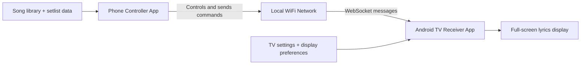
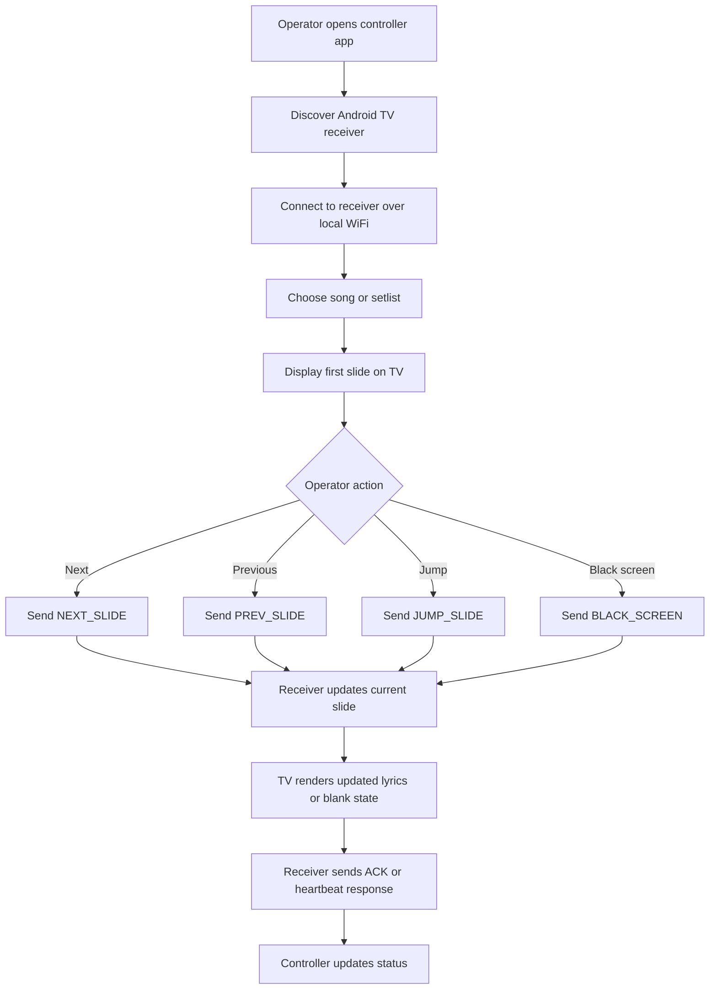
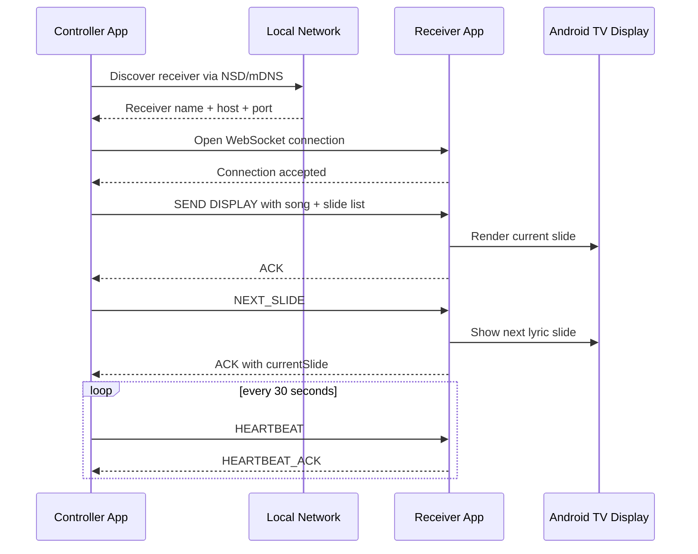

# Mobile Lyrics Presenter for Choirs

A local-network Android app system for showing worship and rehearsal lyrics on an Android TV while a phone acts as the live control surface. The goal is simple: a leader or technician can operate the presentation from a phone, while the TV displays the current lyric slide without depending on a laptop, desktop, or internet connection.

## Why this project exists

Choirs and worship teams often need a presenter that is easy to use from a phone, visible to the room, and reliable in church or rehearsal settings. Most existing presentation tools are designed for desktop computers and are not practical for spontaneous, local-only use.

This project targets the common church workflow:

- Phone in hand as the presenter remote
- Android TV mounted in the room as the display surface
- Same WiFi network or phone hotspot for communication
- Local-only, no internet dependency

## Product goal

The app should allow an operator to:

- browse a song library
- choose a setlist
- move to the next or previous lyric slide
- jump directly to any slide
- blank the screen or return to lyrics instantly

The TV should always render the selected slide in a readable, full-screen, customizable format.

## Feature checklist

- [x] Black blank state on controller connection; status and address are hidden while connected
- [x] Backward-compatible protocol v2 handshake and receiver state ACKs
- [x] Foreground presentation service with bound UI state, reconnect backoff, heartbeat timeout detection, and state restoration
- [x] Receiver blank state on connect with independent background, lyrics, and overlay layers
- [x] Black-screen override preserves the active background and video playback across slide changes
- [x] Reusable HSV/RGB/HEX color picker with presets, brightness, background alpha, and preview
- [x] DataStore persistence for last-used colors and controller templates
- [x] Chunked HTTP media upload to receiver cache with byte-range playback URLs
- [x] Separate lyrics/background/overlay controls, media fit modes, and video playback controls
- [x] Five built-in templates plus editable, duplicable, persistent custom templates
- [x] Collapsible template picker in live control, plus a receiver-matched 16:9 song preview
- [x] Expanded template editor with font family, style, alignment, spacing, fit, overlay, padding, margins, and color controls
- [x] Select a saved template while creating a song or import multiple TXT songs with the selected template applied
- [x] Immersive receiver output with a preferred 4K display mode when the TV supports it
- [x] Human-readable acknowledgement toasts instead of raw ACK payloads in the controller UI
- [x] Dark Spatial visual foundation, shared glass surfaces, and calm success/error message host
- [x] Live navigation and lyrics crossfade motion with large haptic live controls
- [x] Figma design library and Connect → Library → Live → recovery prototype
- [ ] TV device soak/profile validation and physical 1080p media verification
- [ ] Real-device accessibility/contrast and Telugu line-height validation

## High-level architecture

This system is intentionally split into two small Android apps to keep the receiver lightweight and compatible with many Android TV models.



## MVP scope

### Phone controller app
- Song library with create, edit, and delete actions
- Slide editor with verse, chorus, bridge, and custom sections
- Setlist builder and ordering
- Live control buttons for next/previous, jump, black screen, and clear screen
- Local receiver discovery using network scanning
- Connection status indicator with reconnect handling

### TV receiver app
- Full-screen lyrics rendering
- Adjustable font, size, text color, and background
- Black screen and clear-screen states
- Auto-listen for incoming controller commands
- Recovery after brief WiFi dropouts

### Shared infrastructure
- Local network discovery using NSD/mDNS
- WebSocket protocol for slide updates and acknowledgements
- Local persistence for songs and setlists
- Simple pairing flow so setup stays easy

## Core user flow



## Detailed system flow

The app flow is built around a simple local protocol: the controller sends commands, the receiver applies them, and the receiver acknowledges the result.



## Why WebSocket and local discovery

This design is intentionally simple and robust for the church environment:

- WebSockets provide a reliable channel for state updates and command messages
- Local discovery removes the need for manual IP entry in normal use
- Local-only networking means it works in worship spaces without internet access
- A phone hotspot can serve as the network when venue WiFi is limited or missing

## Technical architecture

### Controller app responsibilities
- Manage a local receiver connection
- Discover available TV receivers on the network
- Store and edit songs and setlists locally
- Send slide-change commands and playback states
- Show current connection health and reconnect activity

### Receiver app responsibilities
- Listen for incoming controller connections
- Parse and validate incoming WebSocket content
- Render lyrics on a full-screen display surface
- Maintain current slide state and display theme
- Handle reconnection and heartbeats gracefully

### Shared contracts
- Message models for slide navigation, song state, acknowledgements, and heartbeats
- A consistent JSON schema between phone and TV
- Shared local model definitions for songs, sections, and slides

## Repository layout

```text
d:\slideshow
├── controller/                # Phone controller app
│   └── app/
│       ├── src/main/java/com/lyricsapp/controller/
│       ├── src/main/AndroidManifest.xml
│       └── build.gradle.kts
├── receiver/                  # Android TV receiver app
│   └── app/
│       ├── src/main/java/com/lyricsapp/receiver/
│       ├── src/main/AndroidManifest.xml
│       └── build.gradle.kts
├── shared/                    # Shared protocol and model layer
│   └── src/main/java/com/lyricsapp/shared/
├── PROTOCOL.md                # WebSocket message schema and connection flow
├── PROJECT_PLAN.md            # Feature and build roadmap
├── DEVELOPMENT.md             # Setup and testing instructions
├── QUICK_REFERENCE.md         # Fast dev notes and commands
├── build.gradle.kts          # Root Gradle config
├── settings.gradle.kts        # Multi-module Gradle settings
├── .gitignore                # Ignore rules
├── README.md                 # Project overview
└── LICENSE                   # To be added later if project is open-sourced
```

## Current implementation status

This repository currently contains the Phase 1 foundation for the system:

- WebSocket protocol definitions
- TV receiver app skeleton
- Phone controller app skeleton
- Local discovery logic for a receiver on the network
- Reconnect and heartbeat handling

It is not yet a full production lyrics system, but it establishes the communication layer needed for the full product.

## MVP feature checklist

### Controller app
- [ ] Song library: create, edit, delete songs
- [ ] Slide editor: split lyrics by section and slide
- [ ] Setlist builder: reorder songs in a queue
- [ ] Live control: next, previous, jump, black, clear
- [ ] Receiver discovery: scan local network
- [ ] Connection status: connected, disconnected, reconnecting

### Receiver app
- [ ] Full-screen lyrics display
- [ ] Custom font, size, colors, and background settings
- [ ] Black-screen state
- [ ] Auto-listen for controller connections
- [ ] Graceful reconnect handling after WiFi dropouts

### Shared infrastructure
- [ ] NSD/mDNS discovery
- [ ] WebSocket protocol with heartbeat and ack
- [ ] Local persistence for song library
- [ ] Pairing or connection flow

## Detailed roadmap

### Phase 1: Protocol and connection
- Define WebSocket message schema
- Build bare-bones TV receiver
- Build bare-bones phone controller
- Add local network discovery
- Add reconnect logic and heartbeat flow

### Phase 2: Song model and storage
- Create song and slide entities
- Add Room database
- Save and edit lyrics with local persistence
- Split lyrics into sections and slides

### Phase 3: Live control UI
- Add current and next slide preview
- Add direct jump-to-slide controls
- Build setlist reorder and queue management

### Phase 4: TV display polish
- Replace raw text with full-screen lyric rendering
- Add theme customization and settings persistence
- Add black-screen and clear transitions

### Phase 5: Reliability pass
- Test on different Android TV models
- Validate hotspot mode
- Stress-test rapid input and reconnect events

### Phase 6: Later additions
- Google Cast fallback
- FreeShow import
- Multi-operator support
- Stage-view screen support

## Technical stack

- Kotlin
- Jetpack Compose
- OkHttp for WebSocket networking
- Kotlin serialization
- Android NSD API for local network discovery
- Coroutines for reconnect and background work
- Room for local persistence in later phases

## Quick start

### Requirements
- Android Studio 2023.1 or later
- Android SDK 30+
- Gradle 8.1+
- JDK 11+

### Open the project

1. Open Android Studio
2. Select File > Open
3. Choose the repository root at d:\slideshow
4. Wait for Gradle sync to complete

### Build the project

```bash
cd d:\slideshow
./gradlew build
```

### Run the apps

- Install the receiver app on an Android TV or Android TV emulator
- Install the controller app on a phone or phone emulator
- Connect both devices to the same local WiFi network
- Enter the receiver IP in the controller app and connect
- Use the next/previous controls to validate the message flow

## Example message flow

```json
{
  "type": "DISPLAY",
  "songId": "song-24",
  "songTitle": "Amazing Grace",
  "currentSlide": 0,
  "totalSlides": 3,
  "slides": [
    { "index": 0, "content": "Amazing grace, how sweet the sound" },
    { "index": 1, "content": "I once was lost, but now am found" },
    { "index": 2, "content": "Was blind, but now I see" }
  ],
  "timestamp": 1720000000000
}
```

This payload tells the TV which song section and slide are active. The controller can then send instructions such as `NEXT_SLIDE`, `PREV_SLIDE`, or `JUMP_SLIDE` to move the presentation state.

## Testing and validation strategy

The strongest validation path is to test the messaging flow on real devices because Android TV compatibility is a core requirement.

Recommended checks:

- controller connects to receiver over same WiFi
- next/previous controls trigger updates in real time
- heartbeat remains healthy over a long session
- reconnect succeeds after WiFi dropouts
- phone hotspot can replace venue WiFi
- layout remains readable on a large TV screen

## Project documentation

- PROTOCOL.md — WebSocket schema and connection lifecycle
- PROJECT_PLAN.md — Full build plan and feature checklist
- DEVELOPMENT.md — Setup and testing instructions
- QUICK_REFERENCE.md — Developer notes and commands

## Contributing

This project is a prototype in active development. Contributions are most useful in the following areas:

- reliability of the local connection layer
- Android TV compatibility and discovery behavior
- song editing and setlist UX
- robust controller and display polish

## License

A final project license has not yet been selected. This is still early-stage development.
